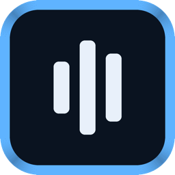
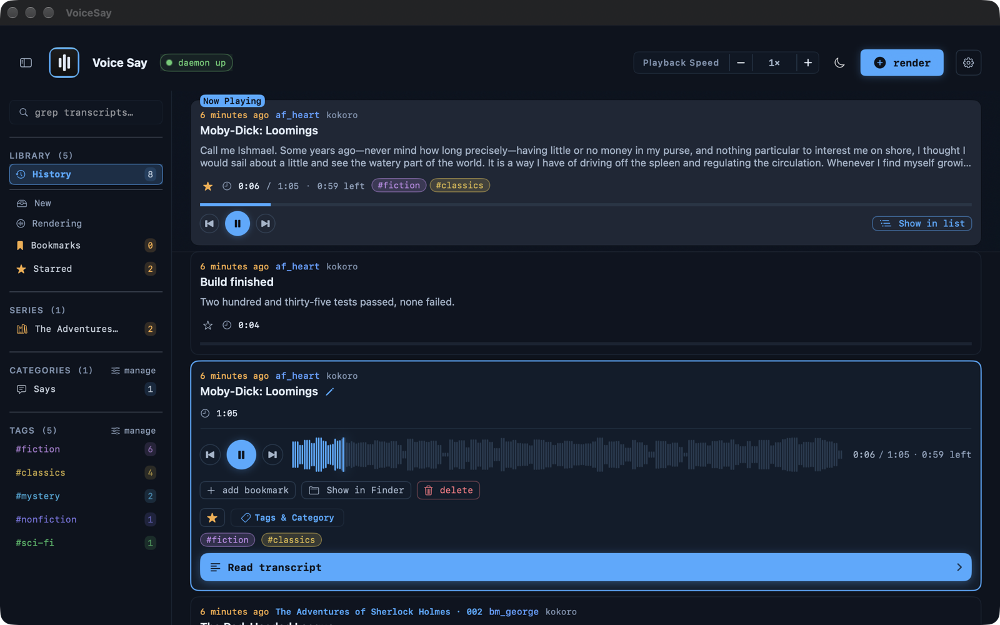
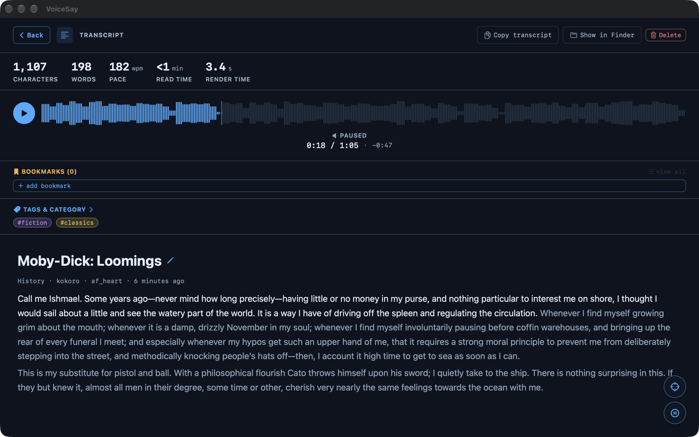
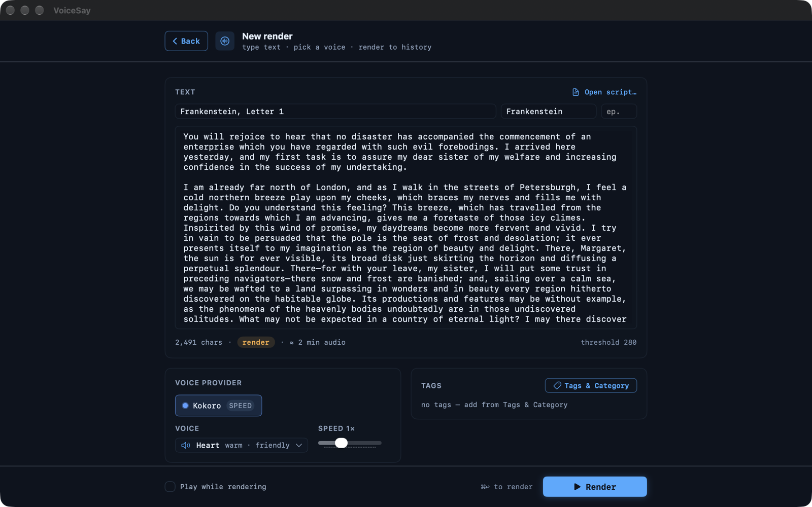

<div align="center">



# voice-say

**Turn any text into audio you keep — rendered on your Mac, saved in a library you can search.**

Local text-to-speech for macOS: a native app with read-along, a CLI your coding agent can call,
and one small daemon behind both. Kokoro by default; any OpenAI-compatible speech server plugs in.

[](LICENSE)
[](#requirements)
[](docs/internals/security.md)


</div>

## What you get

### A library for everything you've listened to

Every render is kept: the audio file, and the full transcript in a local SQLite database. Search
every transcript, star, tag, bookmark, and group episodes into series. Open a row and it plays
right there, with a waveform you can scrub.



### Read along

The reader shows the transcript next to the audio and follows the voice word by word. The word
timings come from macOS's on-device speech recognizer, measured on the audio itself, so every
voice and backend gets them. Nothing leaves the Mac.



### Paste text, pick a voice

Paste an article, a chapter or your own notes, give it a title or a series, choose a voice and a
speed. Long texts render in the background and land in the library when they are done; pause one
and it is kept as a draft you can resume.



### A CLI your agent can drive

`voice-say render` makes audio from a terminal or a script, and the other `voice-say` commands
work the library. Machine-readable output and stable exit codes make it easy for a coding agent;
[`skills/voice-say/SKILL.md`](skills/voice-say/SKILL.md) is a ready Agent Skill.

```bash
voice-say render "Build finished. 235 tests passed."         # speak it, file it in the library
voice-say render --no-play --json --title="Notes from this week" --file=notes.md
voice-say search "rabbit hole" --json                        # full-text search over every transcript
voice-say history --limit 5
```

### Private by default

Synthesis runs on your machine, the daemon listens on `127.0.0.1` only, and there are no accounts
or API keys. Nothing is metered: render as much as your hardware allows.

## Quickstart

On a Mac with Apple silicon and Homebrew:

```bash
brew install mpv socat ffmpeg espeak-ng python@3.12   # the daemon and Kokoro use Python 3.12
make setup            # one-time: Python env + config + `voice-say`/`voice-ctl` in ~/.local/bin
export PATH="$HOME/.local/bin:$PATH"   # if make setup said so; add it to ~/.zshrc to keep it
make kokoro           # one-time: the default speech backend in its own venv
make kokoro-run       # terminal 1: the backend on 127.0.0.1:8000
make run              # terminal 2: the daemon on 127.0.0.1:8890
voice-say render "Hello from voice-say"   # first render downloads + loads the model; then sub-second
make app              # optional: build the macOS app → clients/macos/build/VoiceSay.app
```

The daemon and the speech backend are separate processes; check both with
`curl 'http://127.0.0.1:8890/health?deep=1'`. Renders use the configured default backend/voice
and play immediately — saved to your archive automatically. No account, no keys, nothing leaves
your machine.

## Backends

The daemon does not synthesize audio itself: it sends each render to a speech server over the
OpenAI-compatible `POST /v1/audio/speech` contract. The default is Kokoro-82M (Apache-2.0) on
[mlx-audio](https://github.com/Blaizzy/mlx-audio)'s server, installed by `make kokoro`. Any other
compatible server is an entry with two fields (`url` and `model`); voices are asked from the server when
it lists them. See [docs/setup/backends.md](docs/setup/backends.md).

## Documentation

Start at **[docs/README.md](docs/README.md)**, the full index:

- **Guides**: [User guide](docs/guide/user-guide.md) · [FAQ & troubleshooting](docs/guide/faq.md)
- **Setup**: [Install](docs/setup/install.md) · [Configuration](docs/setup/configuration.md) · [Backends](docs/setup/backends.md) · [Customization](docs/setup/customization.md)
- **Reference**: [CLI](docs/api/cli.md) · [HTTP API](docs/api/http-api.md)
- **How it works**: [Architecture](docs/internals/architecture.md) · [Data model](docs/internals/data-model.md) · [Security](docs/internals/security.md)

## Requirements

- **macOS** with **Python 3.10–3.12** for the daemon and CLI (`make setup` uses `python3.12`, else 3.11, else 3.10; `SETUP_PYTHON=<path>` picks another).
- **`ffmpeg`** for longform chunk concat/trim.
- **`mpv` + `socat`** for CLI playback.
- At least one TTS backend reachable from the daemon (see [docs/setup/backends.md](docs/setup/backends.md)). The default, Kokoro on mlx-audio, needs an Apple silicon Mac, Python 3.12 or older and `espeak-ng`.
- **macOS 26 + Xcode** (or the Command Line Tools for read-along only) for the macOS app and for read-along word timings. Without them `make setup` skips the read-along helper; renders and the CLI work as before.

## Contributing & security

- **Contributions:** pull requests and issues are welcome. **[CONTRIBUTING.md](CONTRIBUTING.md)** has the dev setup, the tests a pull request needs and how to add a backend.
- **[SECURITY.md](SECURITY.md)** — reporting; trust model in [docs/internals/security.md](docs/internals/security.md).

## License

[MIT](LICENSE).
