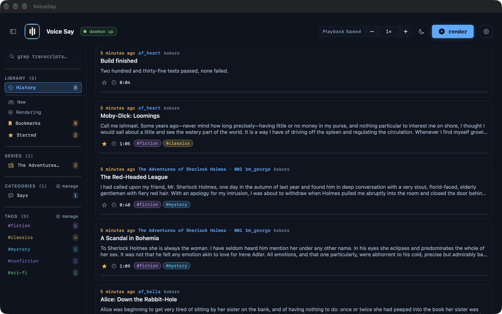

# VoiceSay — macOS app

A native SwiftUI front-end for the voice-say daemon (`127.0.0.1:8890`). It
mirrors the `voice-say` CLI: compose + render text, browse render history, play
back headlessly, and manage the daemon and each TTS backend. Talks to the
daemon over plain HTTP + SSE — start the daemon first (see
[../../docs/setup/install.md](../../docs/setup/install.md)).



## Build & run

```sh
# From this directory:
swift build -c release                   # compile
./build-app.sh                           # assemble + sign VoiceSay.app
open build/VoiceSay.app
```

`build-app.sh` does the full pipeline: `swift build`, assemble the `.app`
bundle, regenerate the icon if `build-icon.py` changed, code-sign (a stable
self-signed identity if present, else ad-hoc). `VOICE_SAY_DESKTOP_LINK=1`
also links it on the Desktop; `VOICE_SAY_ICON=<png>` builds the icon from an
image instead of drawing it. `VOICE_SAY_SAMPLES=<dir>` bundles the
`<voice>.mp3` clips in that directory as voice-picker previews; a voice
without a clip shows no preview. Build artifacts (`.build/`, `build/`,
`*.app`) are gitignored.

The app talks to the daemon at `http://127.0.0.1:8890`. For a daemon on
another port, set the address and reopen the app:

```sh
defaults write local.voicesay.VoiceSay voicesay.daemonURL http://127.0.0.1:<port>
```

## Keyboard

Help ▸ **Keyboard Shortcuts** (`⌘/`) lists every key by the room it works in.
The list is `VoiceSay/Models/ShortcutReference.swift`; `ShortcutReferenceTests`
holds its player rows to the `PlaybackKeys` monitor's map.

## Settings

Settings is a **full-window screen** (not a dialog), opened from the header
gear or the daemon pill. It slides in from the top and is dismissed with the
**Back** button, `Esc`, or a downward swipe on the header. It offers:

- **Services** — per-backend status, with **Start/Stop** for a backend whose
  config names a service (a LaunchAgent or a Docker container); a backend
  without one, like the default kokoro, shows "manual". Daemon
  start/restart/stop appear once its LaunchAgent is installed
  (`daemon/launchd/local.voicesay.daemon.plist.example`); otherwise start it
  with `make run`.
- **Configuration** — writable **default backend** and **default voice**
  pickers (persisted to the daemon via `POST /config`), and read-only daemon
  facts (archive root, db path, say threshold).

## Security posture

- **Hardened runtime: ON** (`codesign --options runtime` in `build-app.sh`).
  The app loads no plugins, does no JIT, and uses no `DYLD_` tricks, so
  hardening costs nothing and closes injection paths.
- **App Sandbox: OFF, by decision.** The app's whole job is localhost daemon
  HTTP/SSE (`127.0.0.1:8890`), a `voice-sayapp.sock` unix socket in the
  per-user temp folder for voice-ctl transport, and reading the voice-archive
  tree wherever the daemon config puts it. Sandboxing would need
  network-client + broad file-access exceptions that defeat the point for a
  local-only tool.
- **Signing:** stable self-signed `VoiceSay Self-Sign` identity (ad-hoc
  fallback) so TCC grants survive rebuilds. Not notarized — local dev
  distribution only, launched via `open`.
- **TCC:** Desktop/Documents usage strings in `Info.plist` cover playing
  renders from an archive root under those folders; the app writes nothing
  there (the daemon owns all writes).

## App icon

The icon is generated procedurally by `build-icon.py` (Pillow → `iconset`
→ `iconutil`), so there is no binary asset to maintain:

- **Glyph** — three white voice-level bars (`#e8f0fa`) on a dark blue square
  (`#0a1320`, matching `Tokens.bg`).
- **Frame** — the app accent, blue `#5fb3ff` (`Tokens.accent`). Change
  `BORDER_ACCENT` in `build-icon.py` to restyle, or build with
  `VOICE_SAY_ICON=<png>` to use your own image.

Regenerate: `python3 build-icon.py` (writes `build/AppIcon.icns`).
`build-app.sh` re-runs it automatically when `build-icon.py` is newer than
the existing `.icns`.
