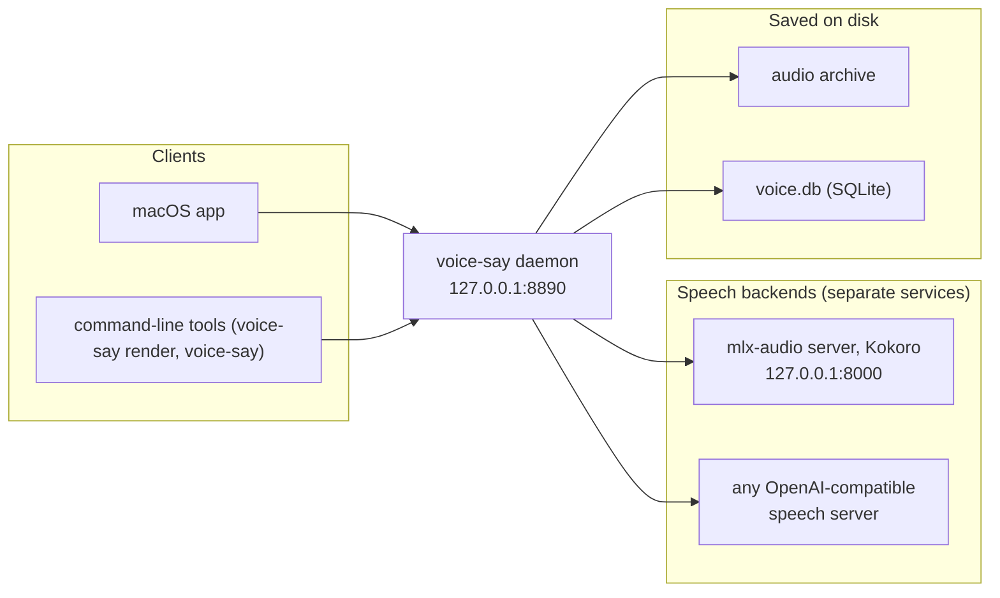

# voice-say

Local-only text-to-speech — turn text into spoken audio, entirely on your own machine.

voice-say is a small text-to-speech system that runs completely on your computer. There are no cloud calls, no API keys, and nothing leaves your machine. You type or send some text, voice-say renders it to an audio file using a local speech backend, and plays it back. A single background service (the **daemon**) does all the work, and several friendly front ends talk to it: a **macOS app**, and two **command-line tools** (`voice-say render` to make audio, the other `voice-say` commands to work the library). Every render is saved to a tidy on-disk archive so you can find and replay it later.

## How it fits together



The clients never touch the speech backends directly. They all funnel through the daemon, which keeps the saved files consistent no matter how you ask for a render.

## 60-second quickstart

Everything below assumes you are in the project folder.

**1. Install (one time).** This builds the Python environment, writes a local config, links the
`voice-say` commands into `~/.local/bin`, and installs the default speech backend (Kokoro) in its own
environment:

```bash
brew install mpv socat ffmpeg espeak-ng python@3.12
make setup
export PATH="$HOME/.local/bin:$PATH"   # if `make setup` said ~/.local/bin is not on PATH
make kokoro
```

**2. Start the backend and the daemon, then render your first line:**

```bash
make kokoro-run    # terminal 1: the speech backend on 127.0.0.1:8000
make run           # terminal 2: the daemon on 127.0.0.1:8890
voice-say render "Hello from voice-say"
```

`make run` starts the daemon only — the speech backend is a separate service (see
[Backends](setup/backends.md)). The render uses the configured default backend/voice
and **plays immediately**. The audio file is saved to your archive automatically.

**3. Play it again any time** by opening the macOS app and clicking the entry in your render history, or re-run `voice-say render` with new text.

## Documentation index

### Guides
- [User guide](guide/user-guide.md) — the macOS app, start to finish
- [FAQ & troubleshooting](guide/faq.md) — common questions and quick fixes

### Setup
- [Install](setup/install.md) — get voice-say running
- [Configuration](setup/configuration.md) — every setting and its default
- [Customization](setup/customization.md) — voices, tags, and personal tweaks
- [Backends](setup/backends.md) — the speech backends and how to choose one
- [Distribution](setup/distribution.md) — the source/repo distribution model

### API reference
- [HTTP API](api/http-api.md) — the daemon's endpoints
- [CLI](api/cli.md) — the `voice-say` commands (`render` included) and their flags

### Internals
- [Architecture](internals/architecture.md) — how the pieces connect
- [Data model](internals/data-model.md) — the audio file and SQLite row a render produces
- [SSE & state](internals/sse-and-state.md) — live updates and playback memory
- [Mock mode](internals/mock-mode.md) — exercise the full render lifecycle with no model
- [Tags](internals/tags.md) — the open tag vocabulary
- [Security](internals/security.md) — the local-only guarantees
- [Tracked core vs private overlay](internals/public-vs-private.md) — what lives in the core vs the overlay

### Overview
- [Overview](product/overview.md) — what voice-say is and what it's for
- [Use cases](product/use-cases.md) — concrete scenarios

### Project
- [Working notes](../CONTRIBUTING.md) — conventions for changing this tree
- [Security notes](../SECURITY.md) — trust model in [internals/security.md](internals/security.md)
- [Roadmap](roadmap.md) — what is planned next
- Decisions (ADRs): [0001 centralize config & private overlay](adr/0001-centralize-and-publishable.md) · [0002 open tag vocabulary](adr/0002-open-tag-vocabulary.md) · [0004 rename to voice-say](adr/0004-rename-to-voice-say.md) · [0006 wav passthrough](adr/0006-wav-passthrough.md) · [0007 cut vault & sqlite store](adr/0007-cut-vault-and-sqlite-store.md) · [0010 `say` becomes `voice-say render`](adr/0010-say-becomes-voice-say-render.md). Numbers are not contiguous.
