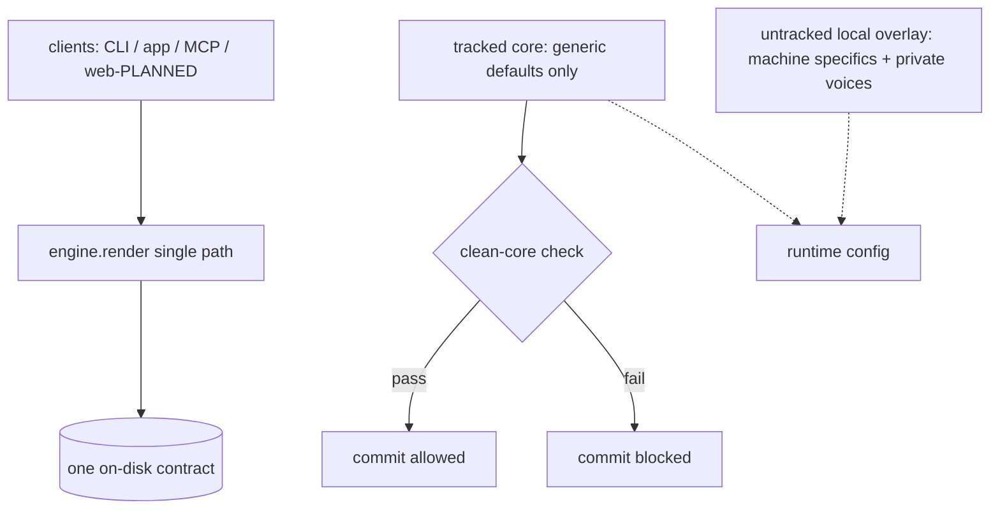

# ADR-0001: Centralize on one canonical repo, keep private voices/overlay out of the tracked core

One source of truth for the render pipeline, plus a standing rule that the tracked
in-house core stays free of private voices, keys, and machine specifics.

- **Status:** Accepted
- **Supersedes:** the prior multi-location, scattered-script arrangement.

## Context

This is an in-house personal tool, not a distributed product. The render pipeline
had grown across several locations: ad-hoc scripts, a client that wrote its own
archive and sidecars, and duplicated logic for the on-disk contract. That created
two recurring problems:

1. **Drift.** The "what gets written where" contract (audio archive, transcript
   sidecar, history line) was implemented in more than one place, so the
   surfaces disagreed about edge cases.
2. **Entangled private data.** Local specifics — machine paths, personal
   voice names, personal tags — and a backend under a non-commercial licence
   were entangled with the code, so the tracked core could not
   be kept clean without a manual scrubbing pass each time.

We want both: a single render path, and a tracked in-house core that never
carries private voices, keys, or a non-commercial backend.

## Decision

**Collapse to one canonical repository** with a single daemon that owns the
render pipeline. Every surface (bash CLI, macOS app, MCP server) funnels
through `engine.render()` so the on-disk contract lives in exactly one place.

Keep a **clean tracked in-house core**: private voices, keys, and any
non-commercial backend stay in a local overlay, never in the
tracked code. Enforced by four rules:

1. **No secrets or private data in tracked code.** Ever, in any commit.
2. **Generic committed defaults.** The tracked config ships only generic values
   (e.g. `default_backend = kokoro`, `default_voice = af_alloy`, loopback-only).
3. **External config overlay for local specifics.** Machine paths, chosen
   backend/voice, tag list, and CORS origins live in an untracked local
   overlay, never in tracked files. Precedence: env > local overlay > committed
   example.
4. **A per-commit readiness gate** (`make publishable-check`) that blocks any
   commit containing secrets, banned terms (private cloned-voice ids), non-generic
   committed defaults, failing tests, or a missing LICENSE/README.

## Consequences

**Positive**

- One render path eliminates contract drift; bugs are fixed once.
- The tracked core stays clean on any commit — private voices, keys, and the
  Research/Non-Commercial backend never leak into it.
- A fresh checkout works from generic defaults with zero edits.
- The overlay cleanly separates "how it works" (tracked) from "how this machine
  is set up, with which private voices" (untracked).

**Negative / costs**

- All machine-specific and private values must be kept out of tracked files and
  in the overlay; the gate enforces this but it is a discipline to maintain.
- The readiness gate adds a step before each commit and can block work until a
  violation is cleaned up.
- Generic defaults mean the committed config is never the "real" local config,
  so first-run setup must materialize the overlay (`make setup`).

**Follow-on**

- The env/config overlay layer is tracked as PLANNED on the roadmap; until it
  lands, the clean-core boundary is upheld by convention plus the gate.
