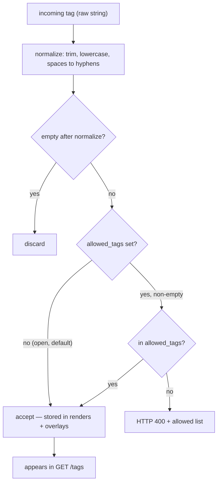

# ADR-0002: Open tag vocabulary (any tag accepted; normalization only)

Tags are open by default — any normalized tag is accepted; `GET /tags` lists what is in use; no proposal queue and no closed list.

- **Status:** Accepted

## Context

Renders can carry tags for browsing, filtering, and grouping in the history view.
An early design used a **closed, curated vocabulary**: tags were checked against
an `allowed_tags` list and unknown tags were rejected. A propose-then-approve
flow (`POST /tags/suggest`) existed for adding new ones.

In practice this was more friction than benefit for the common case. The closed
vocabulary made sense as an optional enforcement mode, but defaulting to it
meant every new deployment had to pre-populate a list before tagging worked at
all. The suggestion endpoint added complexity for no user-visible payoff in the
default posture.

## Decision

The committed default is an **open tag vocabulary**.

- **`allowed_tags = []` (empty list)** — the committed default. Any normalized
  tag is accepted at `/render` and overlay edits. New tags come into existence
  simply by being used.
- **Normalization only.** Every tag is normalized before storage: trim,
  lowercase, spaces→hyphens. So `"Daily Notes"` and `"daily-notes"` collapse to
  `daily-notes`. Normalization is the only enforcement in open mode.
- **`GET /tags`** returns the distinct normalized tags currently in use across
  history. This is the live vocabulary — it grows as new tags are used.
- **`POST /tags/suggest` is removed.** The endpoint does not exist. There is no
  suggestion queue and no proposal-approval workflow.
- **Closing the vocabulary is still possible.** Set `allowed_tags` to a
  non-empty list in your local config overlay. In closed mode `/render` rejects
  unknown tags with HTTP 400 and returns the allowed list. This is an opt-in
  posture for deployments that want a curated vocabulary; it is not the default.

## Consequences

**Positive**

- Zero setup required: tagging works out of the box on a fresh install.
- No proposal queue, no approval step, no endpoint to maintain.
- `GET /tags` is the natural discovery mechanism — call it before a render to
  see what labels are already in use and avoid drift.

**Negative / costs**

- In open mode, callers can introduce near-duplicate tags (e.g. `notes` vs
  `note`). The normalization step prevents casing/spacing variants but not
  semantic near-duplicates. Deployments that care about a clean vocabulary
  should close it with `allowed_tags`.
- The history of closed-vocab enforcement (the old `allowed_tags` behavior)
  remains available as an opt-in config mode, so the codebase still supports
  both paths.

**Mechanisms that are not tags**

- **`star`** — an overlay boolean (`starred`). A favourite flag, not a tag.
- **`completed`** — a playback progress field on the daemon
  (`progress.completed`, set once a render is played to the end). The macOS
  client derives a virtual, undeletable `"completed"` tag from it, surfaced in
  the entry's tag list only after playback reaches the end. Not a user-editable
  classification tag.

These are separate fields to avoid collision between user classification and
system bookkeeping.
