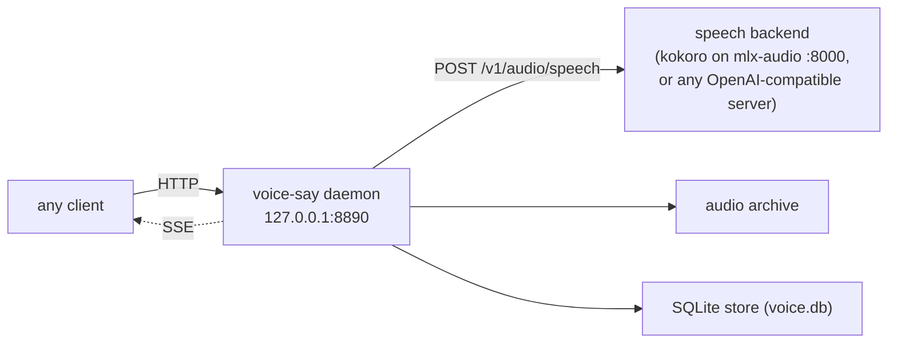

# HTTP API

The complete HTTP reference for the voice-say daemon — the single process that owns the render pipeline and all on-disk state.

The daemon is an `aiohttp` server. By default it binds **loopback only** at `http://127.0.0.1:8890`. Every client (the `voice-say` command line, the macOS app) funnels through these endpoints; the daemon is the single writer of the on-disk archive and the SQLite store, so the saved state stays consistent regardless of which client asked for a render.



## Conventions

- **Base URL:** `http://127.0.0.1:8890` (configurable via `daemon_port`).
- **Content type:** request and response bodies are JSON unless noted (audio is binary; `/events` is an event stream).
- **Error envelope:** every non-2xx response uses one shape:

  ```json
  { "error": "<stage>", "message": "<human-readable detail>" }
  ```

  `error` is a short machine-readable stage/category; `message` is descriptive text.
- **Host guard:** any request whose `Host` is not loopback or a Tailscale address/name, and any POST whose `Origin` is not loopback, the request's own host or `cors_origins`, gets `403 {"error": "forbidden"}`. Clients that send no `Origin` (the CLI, the app, curl) are unaffected. See [security](../internals/security.md).
- **Identity:** a render's `ts` (ISO-8601 UTC timestamp, e.g. `2026-05-29T10:15:30.123456Z`) is the primary key. It addresses the audio (`/audio/{ts}`), playback progress (`/progress/{ts}`), and overlays (`/overlays/{ts}`).

## Endpoint summary

| Method | Path | Purpose |
|---|---|---|
| POST | `/render` | Render text to speech; returns the entry dict |
| POST | `/render_longform` | Chunked longform render → one concatenated mp3 + one renders row |
| POST | `/episode/resume` | Continue a save-and-stop draft into one new merged row |
| POST | `/episode/{id}/cancel` | Cancel an in-flight streaming episode |
| POST | `/episode/{id}/finalize` | Stop-and-save an in-flight streaming episode (save_and_stop) |
| POST | `/episode/{id}/force_finalize` | Stop-and-save NOW — drop the in-flight chunk, keep the completed ones |
| GET | `/history?limit=` | Recent renders, newest first |
| GET | `/search?q=&limit=` | Full-text search over transcripts, newest first |
| GET | `/config` | Daemon version, thresholds, backend list |
| POST | `/config` | Persist runtime-mutable defaults (`default_backend` / `default_voice`) |
| GET | `/events` | Server-Sent Events live stream |
| GET | `/tags` | Tags currently in use across history |
| GET | `/stats` | Lifetime render totals next to what the library holds now |
| GET | `/progress/{ts}` | Read playback progress for one render |
| POST | `/progress/{ts}` | Update playback progress |
| GET | `/overlays/{ts}` | Read overlays (star / tags / bookmarks / soft-delete) |
| POST | `/overlays/{ts}` | Update overlays |
| GET | `/audio/{ts}` | Stream the rendered audio file (path-traversal guarded) |
| GET | `/health?deep=1` | Liveness; optional deep backend probe |
| GET | `/backends` | Backend catalog (id, voices, capabilities) |
| GET | `/voices/{backend_id}` | Voices for one backend |
| POST | `/backends/{backend_id}/restart` | Restart a backend's launchd service (`launchctl kickstart -k`) and wait for it to answer |
| POST | `/reload` | Re-hydrate the in-memory cache from disk |
| POST | `/align/{ts}` | Measure one render's word timings for the reader (read-along alignment) |
| POST | `/playback/active` | Announce active playback (other clients pause) |

---

## POST /render

Render text to speech. This is a **destructive** call: a successful render writes two artefacts (audio file on disk, a `renders` row in the SQLite store). The contract is atomic — if the database write fails, the audio archive is rolled back and no row is committed.

### Request body

```json
{
  "text": "Hello from voice-say.",
  "backend": "kokoro",
  "voice": "default",
  "speed": 1.0,
  "tags": ["briefing"]
}
```

| Field | Type | Required | Default | Notes |
|---|---|---|---|---|
| `text` | string | **yes** | — | Must be non-empty after trimming. Capped at `max_render_chars` (default 200000); empty text or text exceeding the cap is rejected at the `request` stage (`error: "request"`): empty → HTTP 400, over the cap → HTTP 413. |
| `backend` | string | no | the configured `default_backend` | Must be a known backend id (see `GET /backends`). Alias: `backend_id`. |
| `voice` | string | no | backend's `default_voice` | Backend-specific voice id. |
| `speed` | number | no | `1.0` | Honoured only by backends with `supports_speed: true`; ignored otherwise. |
| `tags` | string[] | no | `[]` | Normalized (lowercase; spaces and underscores → hyphens; only `a-z0-9-` kept; hyphen runs collapsed and trimmed). In open-vocabulary mode (default) any tag is accepted. In closed mode (`allowed_tags` non-empty) unknown tags are rejected with HTTP 400. |
| `title`, `series`, `episode` | string, string, int | no | — | Set on the new row's overlay (same rules as `POST /overlays/{ts}`); the response then carries `overlay`. Also accepted by `/render_longform`, and applied to a draft saved from a failed render. A bad `episode` is a 400 before rendering. |

Every render is classified at render time into a **`kind`**: `"say"` when `chars <= say_threshold_chars` (default 280), otherwise `"render"` (see [Configuration](../setup/configuration.md)). The classification is automatic — there is no flag to override it.

### Response — `200 OK`

The returned **entry dict** is the same JSON shape stored in the `renders` table:

```json
{
  "ts": "2026-05-29T10:15:30.123456Z",
  "kind": "say",
  "backend": "kokoro",
  "voice": "default",
  "speed": 1.0,
  "format": "wav",
  "chars": 21,
  "words": 4,
  "duration_s": 1.5,
  "bytes": 72044,
  "archive_name": "voice-hello-from-voice-say-20260529-101530-a3f9.wav",
  "archive_path": "./data/voice-archive/2026/05/voice-hello-from-voice-say-20260529-101530-a3f9.wav",
  "text": "Hello from voice-say.",
  "tags": ["briefing"]
}
```

- `kind` is `"say"` for short renders (`chars <= say_threshold_chars`) and `"render"` otherwise.
- `archive_name` is `voice-<first words>-<YYYYMMDD-HHMMSS UTC>-<4 hex>.<format>`; `format` is the backend's `output_format` (`wav` for `kokoro`).
- `archive_path` is a path on the daemon host (shown here generically as `./data/...`).
- `text` is the full transcript as rendered, stored in the `renders` row (and indexed by FTS5 for `/search`): verbatim, except that emotion tags are removed for a backend without `supports_emotion_tags`.
- `duration_s` is probed from the rendered audio at render time (`0.0` if it could not be probed).

### Status codes

| Status | When | `error` value |
|---|---|---|
| 200 | Render succeeded | — |
| 400 | Missing/empty `text`, malformed JSON, unknown `backend`, bad field type, or a rejected tag (closed-vocab mode only) | `request` |
| 502 | Upstream speech backend failed (network error, non-200, empty audio) | `tts` |
| 500 | Local filesystem failure (archive / database write) or unexpected error | `archive` / `db` / `internal` |

The daemon maps the render pipeline's failure **stage** to the HTTP status: `tts` → 502, `request` (bad input, including a rejected tag in closed-vocab mode) → 400, and the local stages (`archive`, `db`) → 500. Clients (e.g. the CLI) translate these into their own exit codes.

### curl

```bash
curl -sS -X POST http://127.0.0.1:8890/render \
  -H 'Content-Type: application/json' \
  -d '{"text":"Hello from voice-say.","backend":"kokoro","voice":"default"}'
```

---

## POST /render_longform

Render a long text by chunking it, synthesizing each chunk, then concatenating the
results into a **single** mp3 plus **one** `renders` row — the same atomic contract as
`/render`, just composed from many chunks. Accepts the same body fields as `/render`
(`text`, `backend`, `voice`, `speed`, `tags`) plus one extra:

| Field | Type | Required | Default | Notes |
|---|---|---|---|---|
| `mode` | string | no | `"stream"` | Both return the finished entry dict. `"stream"` also broadcasts progressive episode events (`episode_start` / `chunk_ready` / `episode_complete`) over `/events`, so the app shows the render live — whoever started it — and can play before it finishes. `"sequential"` broadcasts nothing until the row lands. An unknown value is rejected with `400` (`error: "request"`). |
| `client_ref` | string | no | — | Echoed on this episode's `episode_start` event (≤ 64 chars), so a client can tell its own episode from one another client started. |

Whatever the mode, the output always lands as a single concatenated mp3 and one
`renders` row; `mode` only changes whether per-chunk SSE events are emitted along the
way. A `200` response carries the canonical entry dict (identical shape to `/render`).

**Seam silence.** Each chunk's leading and trailing silence is trimmed to a uniform
~210 ms pause at every seam between chunks, so stacked dead-air gaps don't accumulate.
The **final** chunk is the exception: its natural trailing tail is preserved (trailing
silence is left untrimmed) so the last word's soft decay isn't clipped — without this,
the very last word would sound cut off. The exception applies in both modes (the
sequential concat and the streaming play-while-render path).

In `mode: "stream"`, the episode can be steered while it is in flight:

- **`POST /episode/{id}/cancel`** — abort the in-flight episode. No row is written; the
  daemon emits a terminal `episode_cancelled` SSE event and the open `/render_longform`
  POST resolves `200` with `{ "cancelled": true, "episode_id": "<id>" }`. `404`
  (`error: "not_found"`) if the id is not a currently rendering episode; `409`
  (`error: "conflict"`) once its chunks are done and the row is being saved.
- **`POST /episode/{id}/finalize`** — stop-and-save: finish the in-flight chunk, stop
  starting new ones, then concatenate what exists into the one canonical mp3 + row and
  emit the normal `episode_complete`. On save-and-stop the resulting row is tagged
  `"draft"` (the macOS app lists it under **Rendering** as a paused draft) and a **resume boundary**
  is persisted on the row — `resume_full_text` (the whole episode text) plus
  `resume_char_offset` (how far rendering got) — so the partial can be continued later
  via `POST /episode/resume`. `404` (`error: "not_found"`) if the id is not currently
  rendering.
- **`POST /episode/{id}/force_finalize`** — stop-and-save **now**. Like `finalize` it
  keeps the already-completed chunks as the one `"draft"` row (with the same resume
  boundary) and emits the normal `episode_complete` (`save_and_stop=true`), but unlike
  `finalize` it does **not** wait for the in-flight chunk: that chunk's synth is
  cancelled and dropped, so a long final chunk can't keep you waiting on the
  "wrapping up" spinner. The dropped chunk's text is simply left for a later resume.
  If no chunk has completed yet there is nothing to keep, so it falls back to a cancel
  (no row, terminal `episode_cancelled`). `404` (`error: "not_found"`) if the id is not
  currently rendering.

### curl

```bash
curl -sS -X POST http://127.0.0.1:8890/render_longform \
  -H 'Content-Type: application/json' \
  -d '{"text":"<long text>","backend":"kokoro","mode":"stream"}'
```

---

## POST /episode/resume

Continue a **save-and-stop draft** (a row finalized early via
`POST /episode/{id}/finalize`) into one new merged render. The daemon re-chunks the
draft's stored `resume_full_text`, **skips** every chunk whose cumulative end is at or
before `resume_char_offset` (the boundary is a clean chunk seam), renders **only** the
remainder, then concatenates `[draft mp3 + new chunks]` into **one** new canonical
`renders` row — and supersedes the draft (its overlay is soft-deleted, `deleted=true`,
so the app shows only the live continuation). The new row's audio is a strict superset
of the draft's.

Resume drives the **same** streaming SSE contract as a fresh stream render
(`episode_start` / `chunk_ready` / `episode_complete` over `/events`), so the
play-while-render client UI works unchanged. A resumed render can itself be stopped early
again — the tail re-persists a fresh resume boundary — so drafts continue recursively.

The POST stays open for the whole render (it resolves only on completion); clients use a
generous timeout (the CLI uses 600s).

### Request body

| Field | Type | Required | Notes |
|---|---|---|---|
| `from_ts` | string | **yes** | The `ts` of the draft render to continue. Missing/empty → `400` (`error: "request"`). |

```json
{ "from_ts": "2026-05-29T10:15:30.123456Z" }
```

### Response — `200 OK`

The canonical **entry dict** for the new merged row (identical shape to `/render`).

### Status codes

| Status | When | `error` value |
|---|---|---|
| 200 | Resume completed; the merged canonical row was committed | — |
| 400 | Missing/empty `from_ts`; the `ts` is unknown; or the row is **not a resumable draft** (`resume_full_text` is NULL) | `request` |
| 409 | A resume of the **same** draft is already in flight — double-click / retry guard; only one in-flight resume per draft is allowed | `conflict` |
| 502 | Upstream speech backend failed while rendering the remainder | `tts` |
| 500 | Local filesystem / database failure (e.g. the draft mp3 is missing) or unexpected error | `archive` / `db` / `internal` |

### curl

```bash
curl -sS -X POST http://127.0.0.1:8890/episode/resume \
  -H 'Content-Type: application/json' \
  -d '{"from_ts":"2026-05-29T10:15:30.123456Z"}'
```

---

## GET /history

Recent renders, newest first — or, with `series`, one series in episode order.

### Query parameters

| Name | Type | Default | Notes |
|---|---|---|---|
| `limit` | int | `200` | Clamped to `[1, 5000]`. Non-numeric values fall back to the default. |
| `series` | string | — | Only that series (case-insensitive), soft-deleted rows left out, ordered by `overlay.episode` (unnumbered last, then by time). |

### Response — `200 OK`

```json
{
  "entries": [ { "ts": "...", "kind": "say", "backend": "kokoro", "voice": "default", "chars": 21, "duration_s": 1.8, "bytes": 28940, "archive_name": "...", "text": "...", "tags": [] } ],
  "total": 1
}
```

`total` is the number of entries returned (after the limit), not the full store size.

### curl

```bash
curl -sS 'http://127.0.0.1:8890/history?limit=20'
```

---

## GET /search

Full-text search over render transcripts, newest first. Runs an FTS5 query against the `renders_fts` virtual table (which indexes each render's full `text`).

### Query parameters

| Name | Type | Default | Notes |
|---|---|---|---|
| `q` | string | — | The FTS5 search query. Empty/missing `q` returns no entries. |
| `limit` | int | `50` | Clamped to `[1, 5000]`. Non-numeric values fall back to the default. |

### Response — `200 OK`

Same `{entries, total}` shape as `/history`; each entry is a full render dict (including `kind` and the full `text`).

```json
{
  "entries": [ { "ts": "...", "kind": "render", "backend": "kokoro", "voice": "default", "chars": 512, "text": "...", "tags": [] } ],
  "total": 1
}
```

### curl

```bash
curl -sS 'http://127.0.0.1:8890/search?q=briefing&limit=20'
```

---

## GET /config

The settings a client needs to render the UI consistently: thresholds and the backend catalog.

### Response — `200 OK`

```json
{
  "version": "x.y.z",
  "say_threshold_chars": 280,
  "default_backend": "kokoro",
  "default_voice": null,
  "allowed_tags": [],
  "archive_root": "./data/voice-archive",
  "db_path": "./data/voice.db",
  "backends": [
    {
      "id": "kokoro",
      "label": "Kokoro",
      "port": 8000,
      "url": "http://127.0.0.1:8000",
      "model": "mlx-community/Kokoro-82M-bf16",
      "default_voice": "af_heart",
      "voices": ["af_heart", "bm_george", "..."],
      "supports_speed": true,
      "supports_emotion_tags": false,
      "accent": "#6ea8ff",
      "output_format": "wav",
      "service": null
    }
  ]
}
```

- `say_threshold_chars` is the cut-off at or below which a render is classified as a `"say"` (otherwise `"render"`).
- `db_path` is the path to the SQLite store on the daemon host.
- `accent` is a hex colour hint for UI consumers.

### curl

```bash
curl -sS http://127.0.0.1:8890/config
```

---

## POST /config

Persist the **runtime-mutable defaults** and live-reload them — no daemon restart. The written values become authoritative for every surface that reads `default_backend` / `default_voice` at render time (the `voice-say` command line, the macOS app).

Three keys are writable. A request must carry at least one of them.

### Request body

| Field | Type | Notes |
|---|---|---|
| `default_backend` | string | Must be a **known backend id** (see `GET /backends`); an unknown id is rejected with `400`. |
| `default_voice` | string \| null | The default voice id. **Not allowlisted** — it is passed through to the backend as-is, so a voice outside the catalog's list is accepted (the advertised `voices` list drives UI pickers, not validation). `null`, `""`, or `"default"` clears it (the backend then picks its own). A non-string (and non-null) value is rejected with `400`. |
| `say_threshold_chars` | int | Cut-off (>= 0) at or below which a render is classified `say`. Live-reloaded; takes effect without restart. A non-integer or negative value is rejected with `400`. |

```json
{ "default_backend": "kokoro", "default_voice": "default" }
```

### Response — `200 OK`

Returns the same body as `GET /config` (reflecting the freshly reloaded values), with one addition: an optional **`warnings`** array. A warning is added when a `VOICE_SAY_DEFAULT_BACKEND` or `VOICE_SAY_DEFAULT_VOICE` environment variable shadows the value just written — the env var wins at read time until it is unset, so the persisted change is inert.

```json
{
  "version": "x.y.z",
  "say_threshold_chars": 280,
  "default_backend": "kokoro",
  "default_voice": "default",
  "allowed_tags": [],
  "archive_root": "./data/voice-archive",
  "backends": [ ... ],
  "warnings": ["VOICE_SAY_DEFAULT_VOICE env var shadows the written value until it is unset"]
}
```

### Status codes

| Status | When | `error` value |
|---|---|---|
| 200 | At least one writable key was applied and persisted | — |
| 400 | Unknown `default_backend`, a non-string `default_voice`, an invalid `say_threshold_chars` (non-integer or negative), malformed JSON, or **no writable key present** | `request` |
| 409 | The existing `config.local.toml` cannot be parsed, so it is left as it is | `config` |
| 500 | The config file could not be written | `config` |

### curl

```bash
curl -sS -X POST http://127.0.0.1:8890/config \
  -H 'Content-Type: application/json' \
  -d '{"default_backend":"kokoro","default_voice":"default"}'
```

---

## GET /events

A **Server-Sent Events** (SSE) stream that lets clients reflect daemon state live, without polling. Used by the macOS app to update its history list, progress bars, and overlays the moment any client changes them.

### Headers

Response: `Content-Type: text/event-stream`, `Cache-Control: no-cache`, chunked transfer encoding.

### Stream shape

On connect the daemon replays a **snapshot** (and any backlog the client missed) and then streams **live** events. Each record is wire-formatted as:

```
id: 3f9c2a7be41d0c55-42
event: progress
data: {"id":42,"type":"progress","ts":"2026-05-29T10:15:30.123456Z","progress":{...}}
```

Event types:

| `event:` | Meaning |
|---|---|
| `render` | A new render was appended to history, or an existing row changed (carries the entry dict; clients replace the row with the same `ts`). Read-along alignment re-sends a row once its word points are stored in `seam_map`. |
| `progress` | Playback progress changed for a `ts`. |
| `overlay` | An overlay (star / tags / bookmarks / soft-delete) changed for a `ts`. |
| `playback_active` | Some client started playing — others should pause to avoid doubled audio. |
| `episode_start` | A streaming longform episode began (no renders row yet; carries the chunked transcript, a predicted total, `prefix_audio_s` — the draft prefix's audio seconds on a resume, `0.0` on a fresh render — and, when set, the row-to-be's `title` / `series` / `episode`: the request's on `/render_longform`, the draft's on `/episode/resume`). |
| `chunk_ready` | A chunk of a streaming episode finished (carries the cumulative render-head offset). |
| `episode_complete` | A streaming episode finished and its canonical renders row was committed. |
| `episode_cancelled` / `episode_error` | Terminal episode states (cancel / failure). On failure the finished chunks are saved: `episode_error.saved_ts` names the row (`partial: true` = a resumable draft tagged `draft`; `null` when nothing had finished). The failed POST's error body carries the same `saved_ts` / `partial`. |

The `episode_*` and `chunk_ready` events are **ephemeral** and appear only during a
`POST /render_longform` with `mode: "stream"`; they ride the same `/events` bus as the
canonical `render` event.

To keep the connection warm and flush buffered chunks promptly, the daemon writes an SSE comment keepalive every ~15 seconds of quiet:

```
:keepalive
```

### Reconnect with Last-Event-ID

Every event's `id:` is `<instance_id>-<seq>`: a per-process tag and a monotonic sequence (the JSON `id` is the sequence alone). On reconnect, send the last `id:` you received, unchanged, in the `Last-Event-ID` request header; the daemon resumes from the next event so you don't miss or duplicate any. An id from an earlier daemon process (the daemon restarted), an absent or an unparseable header starts from the full snapshot. A bare integer is taken as a sequence of the running process.

### curl

```bash
# Stream live
curl -sN http://127.0.0.1:8890/events

# Reconnect, resuming after event 42 of this daemon process
curl -sN -H 'Last-Event-ID: 3f9c2a7be41d0c55-42' http://127.0.0.1:8890/events
```

---

## GET /tags

Tags currently in use across render history. Tags use an **open vocabulary** by default: any normalized tag is accepted at `/render`, and this endpoint returns the distinct tags that have been used.

### Response — `200 OK`

```json
{ "tags": ["briefing", "draft", "daily-notes"] }
```

> Tag normalization: lowercase; spaces and underscores become hyphens; only `a-z0-9-` is kept; hyphen runs are collapsed and trimmed. So `"Daily Notes"` and `"daily-notes"` collapse to one tag. `star` (an overlay boolean) and playback `completed` (a progress field) are mechanisms, not stored tags — this endpoint returns only the tags persisted server-side.
>
> The macOS client, however, surfaces a virtual `"completed"` tag derived from the `progress.completed` field (see [`/progress/{ts}`](#post-progressts)): once a render has been **played to the end** it auto-appears in that client's tag list and is read-only (it cannot be removed via the overlay tag API, and it is re-derived rather than stored). It does **not** appear in this server-side `/tags` aggregate.

### curl

```bash
curl -sS http://127.0.0.1:8890/tags
```

---

## GET /stats

How much has been rendered over the daemon's lifetime, next to what the library holds now. `lifetime` is a running total bumped on every new render and never decreased, so deleting recordings (audio files or rows) does not lower it; `since` is the earliest render it includes. `library` counts renders that are not soft-deleted and whose audio file exists.

### Response — `200 OK`

```json
{
  "lifetime": { "renders": 120, "chars": 450000, "words": 75000, "duration_s": 30000.0, "bytes": 960000000, "since": "2026-01-01" },
  "library":  { "renders": 100, "duration_s": 25000.0, "bytes": 800000000 }
}
```

> A render row deleted anyway (renders is append-only; deletion is manual) keeps its transcript in the `deleted_scripts` table of `voice.db`.

### curl

```bash
curl -sS http://127.0.0.1:8890/stats
```

---

## GET /progress/{ts}

Read the playback progress aggregate for one render. Progress is **mutable client-state** (deletable without losing render history).

### Response — `200 OK`

```json
{
  "ts": "2026-05-29T10:15:30.123456Z",
  "played_s": 12.3,
  "duration_s": 45.6,
  "play_count": 2,
  "completed": false,
  "last_played": "2026-05-29T10:20:00.000000Z"
}
```

`404` with `error: "not_found"` if no progress exists for the `ts`.

`completed` is `true` once the listener has **played** this render through to the end (`played_s >= duration`). It is a *playback*-completion signal, distinct from render completion (whether the audio finished synthesizing). The macOS client gates a virtual, undeletable `"#completed"` tag on this field — see the [`/tags`](#get-tags) note.

### curl

```bash
curl -sS http://127.0.0.1:8890/progress/2026-05-29T10:15:30.123456Z
```

## POST /progress/{ts}

Update playback progress. Fields not sent inherit from the previous row (latest-wins per field; the stored row is whole, so reads never merge).

### Request body

| Field | Type | Required | Notes |
|---|---|---|---|
| `played_s` | number | **yes** | Seconds played; must be `>= 0`. |
| `duration_s` | number | no | Sticks once known; may be omitted on follow-up writes. |
| `completed` | bool | no | Marks the render as fully played. |
| `started` | bool | no | `true` on the first POST of a new playback session — bumps `play_count`. Subsequent ticks pass `false`. |

```json
{ "played_s": 12.3, "duration_s": 45.6, "started": true }
```

### Status codes

`200` on success; `400` (`error: "request"`) for a missing `played_s` or a negative value.

### curl

```bash
curl -sS -X POST http://127.0.0.1:8890/progress/2026-05-29T10:15:30.123456Z \
  -H 'Content-Type: application/json' \
  -d '{"played_s":12.3,"duration_s":45.6,"started":true}'
```

---

## GET /overlays/{ts}

Read the overlay state for one render: star, soft-delete, user tags, and bookmarks. Like progress, overlays are **mutable client-state** — deleting them loses bookmarks/stars but never touches audio or the `renders` row.

### Response — `200 OK`

```json
{
  "ts": "2026-05-29T10:15:30.123456Z",
  "starred": true,
  "deleted": false,
  "tags": ["briefing"],
  "bookmarks": [ { "id": "b1", "position": 0.42, "note": "key point" } ],
  "last_modified": "2026-05-29T10:21:00.000000Z"
}
```

`404` with `error: "not_found"` if no overlay exists for the `ts`.

### curl

```bash
curl -sS http://127.0.0.1:8890/overlays/2026-05-29T10:15:30.123456Z
```

## POST /overlays/{ts}

Update overlays. Send the whole overlay; fields you omit inherit the previous value.

### Request body

| Field | Type | Notes |
|---|---|---|
| `starred` | bool | Star/unstar the entry. |
| `deleted` | bool | Soft-delete (hide in lists; audio/history untouched). |
| `tags` | string[] | Normalized + deduped. Any tag is accepted in open-vocabulary mode (default). |
| `removed_tags` | string[] | Tag-suppression list: tags the user has cleared from this entry. Render history (`entry.tags`) is immutable, so the effective tag set a client shows is (server ∪ overlay.tags) − removed_tags. |
| `title` | string | User-set display title; overrides the client-derived (first-sentence) title. `""` clears it back to derived. |
| `series` | string | Series name. `""` or `null` removes the entry from its series. |
| `episode` | int | Episode number in the series, a whole number ≥ 0. `null` clears it. |
| `bookmarks` | object[] | Each: `{ "id": string, "position": number 0.0–1.0, "note": string }`. Out-of-range positions are dropped. |

```json
{ "starred": true, "tags": ["briefing"], "bookmarks": [ { "id": "b1", "position": 0.42, "note": "key point" } ] }
```

### Status codes

`200` on success; `400` (`error: "request"`) if a field is malformed or (in closed-vocab mode) a newly added tag is not canonical.

### curl

```bash
curl -sS -X POST http://127.0.0.1:8890/overlays/2026-05-29T10:15:30.123456Z \
  -H 'Content-Type: application/json' \
  -d '{"starred":true,"tags":["briefing"]}'
```

---

## GET /audio/{ts}

Stream the rendered audio file for a render.

### Response — `200 OK`

Binary audio. `Content-Type` matches the render format: `audio/mpeg` (mp3), `audio/wav` (wav), `audio/L16` (pcm), or `application/octet-stream` as a safe fallback. `Content-Disposition: inline` carries the filename.

### Path-traversal guard

The daemon resolves the entry's stored `archive_path` and verifies it lives **inside** the configured archive root before serving it. A maliciously seeded entry whose path escapes the archive root (e.g. pointing at a system file) is refused with `403` (`error: "forbidden"`).

### Status codes

| Status | When |
|---|---|
| 200 | Audio streamed |
| 404 | No render with that `ts`, the entry has no `archive_path`, or the file is no longer on disk |
| 403 | `archive_path` resolves outside the archive root |

### curl

```bash
curl -sS http://127.0.0.1:8890/audio/2026-05-29T10:15:30.123456Z --output render.mp3
```

---

## GET /health

Liveness and version. Add `?deep=1` to also probe each speech backend (a few short HTTP pings).

### Response — `200 OK`

```json
{
  "status": "ok",
  "version": "x.y.z",
  "db_path": "./data/voice.db",
  "archive_root": "./data/voice-archive",
  "queue": { "waiting": 0, "episode_running_s": null }
}
```

`queue.waiting` counts renders waiting for their turn; `queue.episode_running_s` is how long the running longform episode has been going (`null` when none).

With `?deep=1`, a `backends` map is added (`up` / `down` per backend id):

```json
{ "status": "ok", "version": "x.y.z", "backends": { "kokoro": "up" } }
```

### curl

```bash
curl -sS 'http://127.0.0.1:8890/health'
curl -sS 'http://127.0.0.1:8890/health?deep=1'
```

---

## GET /backends

The backend catalog: every registered speech backend with its voices and capabilities.

### Response — `200 OK`

```json
[
  {
    "id": "kokoro",
    "label": "Kokoro",
    "port": 8000,
    "url": "http://127.0.0.1:8000",
    "model": "mlx-community/Kokoro-82M-bf16",
    "default_voice": "af_heart",
    "voices": ["af_heart", "bm_george", "..."],
    "supports_speed": true,
    "supports_emotion_tags": false,
    "accent": "#6ea8ff",
    "output_format": "wav",
    "service": null
  }
]
```

Each backend advertises a `supports_emotion_tags` capability. For backends with `supports_emotion_tags: false` (e.g. `kokoro`) the daemon strips inline bracketed `[emotion]` markers and collapses whitespace before sending text to the engine. Backends with `supports_emotion_tags: true` receive the markers intact so the engine can interpret them.

### curl

```bash
curl -sS http://127.0.0.1:8890/backends
```

---

## GET /voices/{backend_id}

The voices available for one backend.

### Response — `200 OK`

```json
{ "backend": "kokoro", "voices": ["af_heart", "bm_george", "..."] }
```

Voices come from the catalog entry's `voices`, or, when the entry leaves it out, from the backend's own `GET /v1/audio/voices?model=` (asked once and cached; a backend that does not list voices gives `[]`). `404` with `error: "unknown_backend"` if the backend id is not registered.

### curl

```bash
curl -sS http://127.0.0.1:8890/voices/kokoro
```

---

## Maintenance endpoints

These exist for tooling and are rarely called directly by UI clients.

### POST /reload

Re-hydrate the daemon's in-memory cache from the SQLite store. A process that writes to the store outside the daemon (an import script, a manual edit) calls this after writing to the store so live clients and SSE subscribers see new rows without restarting the daemon.

```bash
curl -sS -X POST http://127.0.0.1:8890/reload
# → {"ok": true, "counts": {"history": 128, "progress": 40, "overlays": 12}}
```

### POST /backends/{backend_id}/restart

Restart the backend's launchd service from the catalog entry's `service` (`{"kind": "launchd", "label": "…"}`) with `launchctl kickstart -k`, then wait up to a few seconds for it to answer. Only a catalog id is accepted, never a free label. It is for a client that can reach the daemon but cannot run `launchctl` itself.

| Status | When |
|---|---|
| `200` | `{"backend", "label", "restarted": true, "up", "waited_s"}` |
| `404` | Unknown backend id |
| `409` | The entry has no launchd service (`no_service`), or a render is running or queued (`busy`) |
| `502` | `launchctl` failed |

```bash
curl -sS -X POST http://127.0.0.1:8890/backends/kokoro/restart
```

### POST /align/{ts}

Measure one render's word timings from its audio and store them as its `seam_map`, the points the app's reader highlights through; the row is then re-sent as a `render` event. New renders are aligned automatically once their row lands; this is for rows rendered before that, and is what `voice-say align` calls. Alignment uses macOS's on-device speech recognizer through a small helper that `make setup` builds (`daemon/.build/voice-say-words`, macOS 26+), and `align = true` (the default). Runs one at a time and only while no render is in progress, so it never slows one (the request waits until the renders finish); an 18-minute episode takes about 16 s on an M2 Pro. `GET /health` shows it under `alignment`.

```bash
curl -sS -X POST http://127.0.0.1:8890/align/2026-05-29T10:15:30.123456Z
# → {"ok": true, "ts": "2026-05-29T10:15:30.123456Z", "points": 500}
```

`503` when alignment is off, `404` for an unknown `ts`, `422` when the alignment failed (the row keeps its seams; the daemon log says why).

### POST /playback/active

Announce that a client started playing. The daemon broadcasts a `playback_active` SSE event so other clients can pause and avoid doubled audio.

```bash
curl -sS -X POST http://127.0.0.1:8890/playback/active \
  -H 'Content-Type: application/json' \
  -d '{"source":"cli","ts":"2026-05-29T10:15:30.123456Z"}'
```

`400` (`error: "request"`) if `source` is missing.
