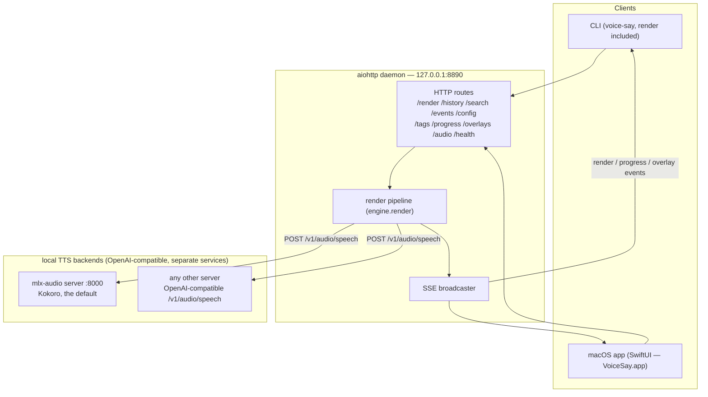
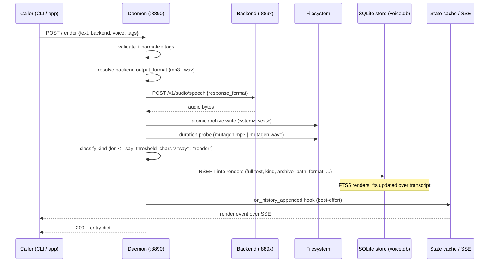
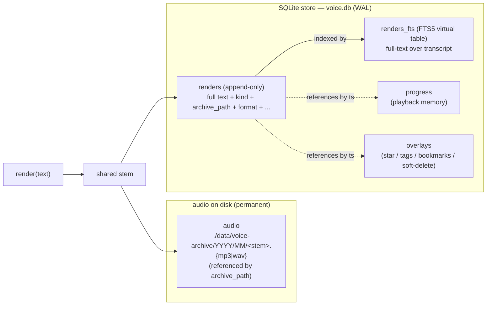
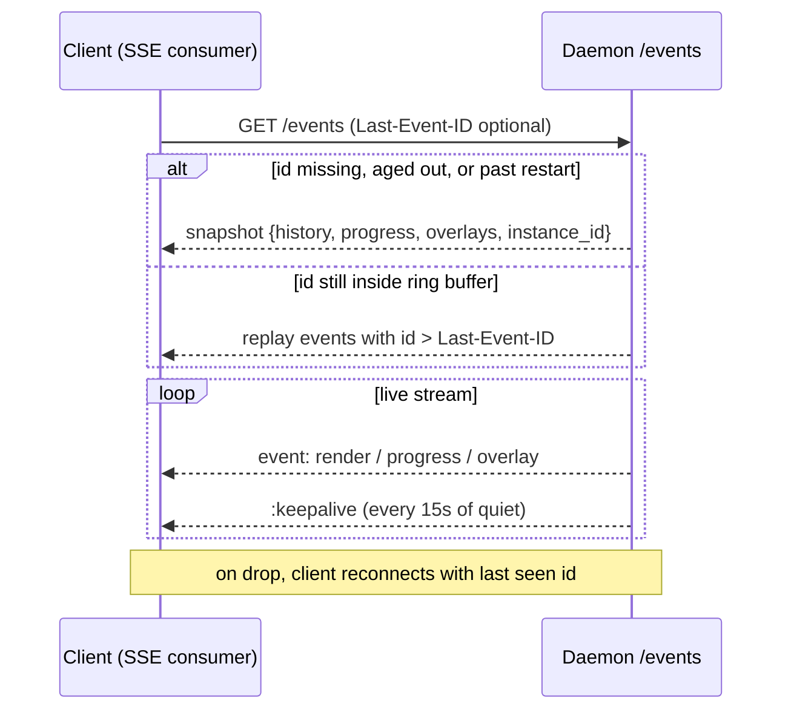
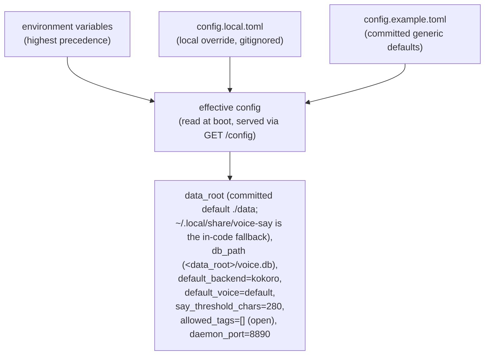
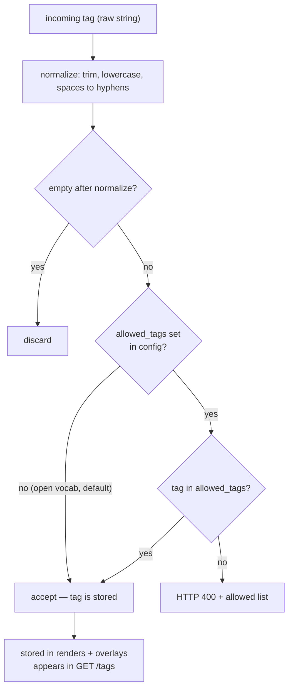
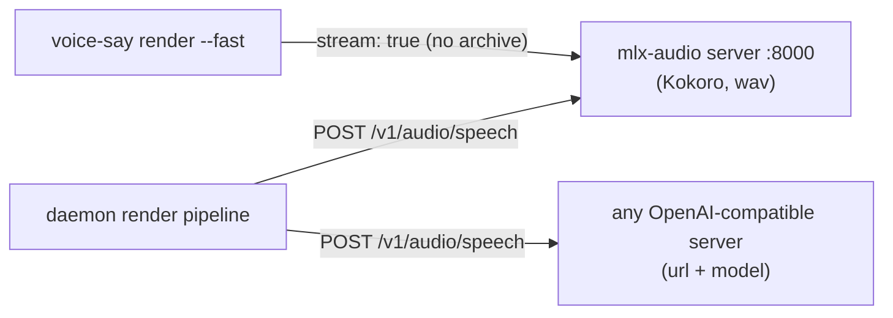
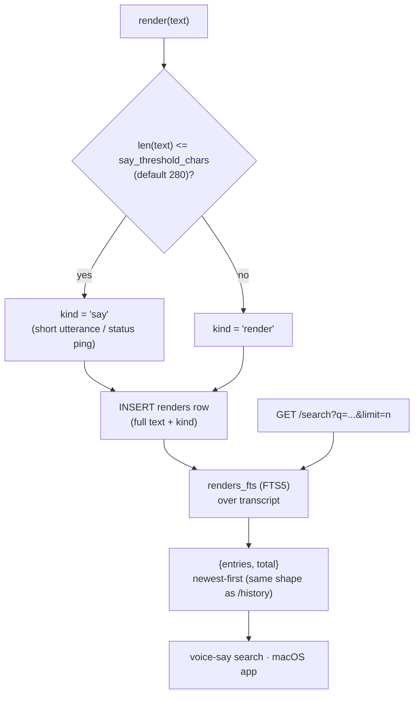
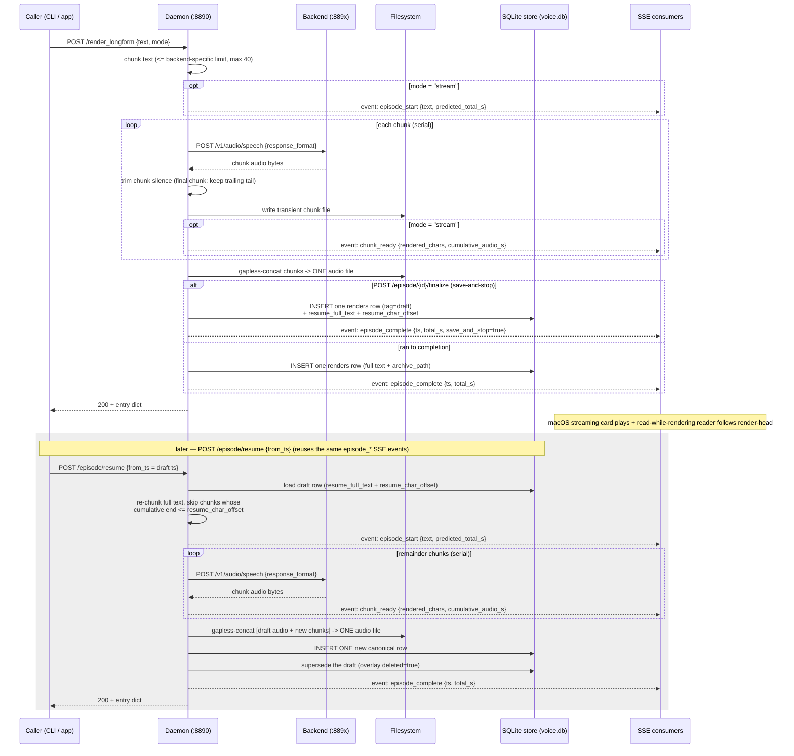

# voice-say — Diagrams Gallery

A curated set of valid Mermaid diagrams covering the architecture, render
pipeline, long-form / streaming render, data lifecycle, event flow,
configuration, tag policy, and backend topology of voice-say — a local-only
text-to-speech system.

All diagrams use generic labels. The daemon, the config layer, the backend
catalog (one `kokoro` entry on mlx-audio's server, a separate service outside
this repo), the consolidated **SQLite store** (`voice.db`, WAL) with FTS5
transcript search, and one-command daemon setup are all **shipped**. The client
surfaces are the **CLI** (`voice-say`, `render` included) and the **macOS app**.

---

## 1. System Architecture

Thin client surfaces (the CLIs and the macOS app) all
funnel through one local aiohttp daemon on `127.0.0.1:8890`, which drives the
pluggable TTS backends and broadcasts render/progress/overlay events back to
every client over Server-Sent Events.

---

## 2. Render Sequence

A single `/render` call: the daemon validates input, posts to the chosen backend,
writes the audio atomically using the backend's own format, classifies the render
into a `kind` (`say` vs `render`) by transcript length, inserts one row (full
transcript + metadata) into the SQLite store, fires the in-memory cache hook, and
returns the entry dict.

---

## 3. Data / Artefact Lifecycle

Every render produces two artefacts under a shared `<stem>` — the audio file on
disk and one row in the SQLite store. The audio extension follows the backend's
format (`.mp3` or `.wav`); the row in `renders` carries the **full transcript**
plus all metadata (`kind`, `archive_path`, `format`, tags, duration, ...). State
lives entirely in `voice.db` (WAL mode): the append-only `renders` table, the
mutable `progress` and `overlays` tables, and the `renders_fts` FTS5 virtual
table over the transcript. No vault sidecars, no JSONL files, no manual locking
or compaction.

---

## 4. SSE Event Flow + Reconnect

On connect the daemon either replays buffered events (when `Last-Event-ID` is
still inside the ring buffer) or sends a full snapshot; after that it streams
live render/progress/overlay events with periodic keepalives.

---

## 5. Config Precedence

Configuration resolves from environment variables first, then a local override
file, then committed example defaults — `env > config.local.toml >
config.example.toml`. The daemon reads the effective config at boot and exposes
it to clients via `GET /config`. Generic committed defaults work with zero edits
once a backend is up.

---

## 6. Tag Normalization Flow

Tags use an **open vocabulary** by default (any normalized tag accepted). The
`allowed_tags` config key can close the vocabulary; `GET /tags` always shows
the distinct tags in use.

---

## 7. Backend Topology

All TTS backends run locally and speak the OpenAI-compatible
`POST /v1/audio/speech` contract. Each is its own service, outside this repo:
the committed default is Kokoro on mlx-audio's server (`:8000`); any other
server with that contract is one catalog entry (`url` + `model`). A backend
that understands inline emotion tags says so with `supports_emotion_tags`.
`voice-say render --fast` skips the daemon and streams from a backend directly
(`stream: true`).

---

## 8. Render Kind + Transcript Search

At render time every entry is classified into a **`kind`** by transcript length:
`say` when `len(text) <= say_threshold_chars` (default **280**), else `render`.
"Says" are short utterances / status pings; the macOS app surfaces them as a
built-in category. The same `voice.db` powers full-text search — the daemon's
`GET /search?q=<query>&limit=<n>` HTTP endpoint runs FTS5 over the `renders_fts`
transcript index (newest-first) and returns the same `{entries, total}` shape as
`/history`; `voice-say search` and the macOS app expose the matching capability.

---

## 9. Long-form / Streaming Render

`POST /render_longform` is a first-class path for text too long for a single
render: it chunks the input (≤ a **backend-specific** char ceiling — default
**1200** chars/chunk; a backend that stitches long input itself can set e.g.
**12500** for whole-module POSTs; capped at **40** chunks), renders chunks serially, then
**gapless-concats** them into **one** audio file plus **one** `renders` row —
so a long episode lands as a single archive artefact, not N fragments. Before
the concat, each chunk's leading + trailing silence is trimmed to a uniform
~210 ms seam pause, **except the final chunk** which keeps its natural trailing
tail so the last word's soft decay isn't clipped. In `mode="stream"` the daemon
also broadcasts `episode_start` / `chunk_ready` / `episode_complete` over SSE so
a client can play and read while the render is still in flight. The macOS app
shows a provisional streaming card (play-while-rendering, before any `voice.db`
row exists) and drives a read-while-rendering transcript reader from
`episode_start.text` (the full chunked transcript) + `chunk_ready.rendered_chars`
(the render-head char offset).

`POST /episode/{id}/finalize` is **save-and-stop**: instead of cancelling, the
in-flight episode keeps the audio rendered so far as **one** `renders` row tagged
**`draft`** (the `draft` tag persists; the macOS app surfaces drafts in the
**Rendering** bucket) and persists a resume boundary — the validated full
chunked text (`resume_full_text`) plus the char offset already rendered
(`resume_char_offset`), two NULLABLE columns set *only* on a draft row.
`POST /episode/resume` (body `{"from_ts": "<draft ts>"}`) later continues it:
re-chunk the stored full text, skip the chunks whose cumulative end is already
inside the rendered prefix, render only the remainder, gapless-concat
`[draft audio + new chunks]` into **one new** canonical row, and supersede the
draft (overlay `deleted=true`) — reusing the **same** `episode_start` /
`chunk_ready` / `episode_complete` SSE contract as a fresh stream render.

> The single-`/render` path (diagram 2) stays the default for short text; only
> `/render_longform` chunks. `/episode/{id}/cancel` (drop everything, write no
> row) and `/episode/{id}/finalize` (**save-and-stop** — keep the rendered-so-far
> audio as one `draft` row with a persisted resume boundary) control an in-flight
> streaming episode; `POST /episode/resume` later continues a draft. On failure
> the stream emits `episode_error` in place of `episode_complete`. A double-fired
> resume of the same draft is rejected with `409 conflict` (one in-flight resume
> per draft); the POST stays open until completion (client uses a 600s timeout).
