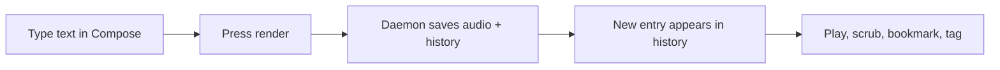

# User guide

A start-to-finish walkthrough of the voice-say macOS app: render text, replay it, and organize your library.

This guide is written for everyday use. You do not need to know any programming. If something goes wrong, jump to the [FAQ & troubleshooting](faq.md).

## Before you start

voice-say has two parts that work together:

- **The daemon** — a small background service that actually turns text into audio. It must be running.
- **The macOS app** — the window you click around in. It talks to the daemon.

Start the daemon with `make run` (see the [install steps](../setup/install.md)) before you open the app. The app shows a clear message if the daemon is not reachable; its start button works once the daemon is set up to [start at login](../setup/install.md#optional-start-the-daemon-at-login-launchd).

## Launching the app

Open the voice-say app the way you open any Mac app. When it starts, it connects to the daemon and loads your render history. If this is a brand-new install, the history will be empty — that is normal.

> You build the app from source (`make app` in the project folder); it is signed with a self-signed certificate (not notarized). Because it is built locally rather than downloaded, macOS lets it run without a Gatekeeper prompt, and the stable signature means any permission you grant (microphone, etc.) sticks across rebuilds. No Apple account is needed. (See [distribution.md](../setup/distribution.md).)

## Making your first render

1. Open the **Compose** pane.
2. Type or paste the text you want spoken.
3. Pick a **voice** and a **backend** if you want something other than the defaults. The defaults (`kokoro`, voice `af_heart`) work once mlx-audio's server runs (see [Backends](../setup/backends.md)).
4. Press the render button.

The daemon renders the audio, saves it to your archive, and the new item appears at the top of your history. Playback can begin right away.

## Browsing your render history

The main view is a **history list**, a scrollable list of bordered cards, newest on top. Each card shows the text, the voice and backend used, a relative time and the date it was made, and how long the audio runs. Scroll to browse. The list updates **live** — if a render is made from the command line or by an AI agent while the app is open, it shows up on its own without a refresh.

## Playing, scrubbing, and bookmarking

Click any entry to expand an **inline player**:

- **Play / pause** the audio. Because voice-say uses native macOS playback, your keyboard media keys and Control Center work too.
- **Scrub** along the **waveform** to jump to any moment in the clip.
- **Bookmark** spots inside a long clip so you can return to them later. Bookmarks are saved per entry.
- **Resume where you left off** — the app remembers your playback position, so reopening a long render picks up where you stopped.

## Starring favourites

Click the **star** on any entry to mark it a favourite. Starring is just a quick flag for "I want to find this again" — it does not change the audio or the text. You can star and unstar freely.

## Applying tags

**Tags** are short labels that help you group and find renders (for example, a project name or a category). To tag an entry, open it and type or select a tag.

voice-say uses an **open tag vocabulary** by default — you can use any label you like. Tags are normalized (lowercase, spaces become hyphens) so `"Daily Notes"` and `"daily-notes"` are the same tag. `GET /tags` always shows the distinct tags in use across your history. (The command-line `voice-say` takes only tags already in use unless you coin one on purpose with `--new-tag`; see the [FAQ](faq.md#how-do-i-add-a-new-tag).)

> If the owner of this install has set a closed `allowed_tags` list in the config, only those tags are accepted. Open an entry and the available tags will reflect what is allowed.

## Says vs. renders

Every render is sorted into one of two **kinds** at the moment it is made:

- **Say** — a short utterance: a heads-up, a confirmation, a quick note read aloud ("Done!", "Build finished"). A render counts as a "say" when its text is at or under the length threshold (by default, **280 characters**).
- **Render** — anything longer: a summary, a narration, a passage of prose.

The app surfaces **says** as a built-in category so the quick one-liners do not bury the longer renders you want to revisit.

The kind is just a label for organizing your library — it does **not** change what is stored. The audio is saved to your archive and the **full transcript** is kept for every render, short or long, so you can always read back exactly what was spoken and search across everything. The threshold is configurable — see [Configuration](../setup/configuration.md).

| Render length | Kind | Audio saved? | Full transcript kept & searchable? |
|---|---|---|---|
| At or under threshold | `say` | Yes | Yes |
| Over threshold | `render` | Yes | Yes |

## Searching your transcripts

Because the full transcript of every render is stored, you can **search** across your whole library by what was spoken — not just scroll. Type a query and voice-say returns matching renders newest-first, the same way history is listed. This is handy for finding "that summary about the migration" without remembering when you made it.

## Reading along

Open any render's transcript (the **Read transcript** button, pinned at the lower-right of an expanded card). While the render plays, the text **highlights read-vs-unread**
in step with the audio and auto-scrolls to keep the read position in view — a
hands-free read-along. If you start a **stream (play while rendering)** render,
the reader shows three states as it streams: already-read (bright), rendered and
ready (muted), and not-yet-rendered (grayed) — so you can see exactly how far the
render has reached. You can rename a render's title inline from the expanded card
(the pencil after the title) and bookmark moments as you listen.

## Watching a stream render

While a **stream (play while rendering)** render is in flight, a live status line tells you what is happening. Before the first chunk arrives there is nothing to play yet, so the line cycles through what the daemon is actually doing — **Preparing…**, then **Warming up the voice…**, then **Rendering the first chunk…**. Once chunks start landing it switches to **Rendering chunk K of N…** and counts up. When every predicted chunk is in, it reads **Finishing up…** while the daemon stitches and encodes the final file, and **Finishing current chunk…** if you have asked it to stop early. The same status line is shown on the streaming card and in the transcript header, so they always agree.

## Stopping a render early and continuing later

You do not have to wait for a long stream render to finish. The persistent global control strip was removed; the stop controls now live as StreamingRenderControls (Pause / Stop Now / Delete) on the streaming card and in the reader's control bar. While it is in flight you get:

- **Pause** — finishes the chunk currently rendering, then keeps everything produced so far as a resumable draft. While that chunk finishes, the status reads **Finishing current chunk…** and a **Stop Now** button appears: press it to drop even that in-flight chunk and finalize immediately, keeping the chunks already done. The partial render lands in the **Rendering** bucket (as a paused draft) either way.
- **Delete** — stops and throws the whole render away, keeping nothing.

A saved Draft is a normal entry you can play and read like any other, plus it has a **Continue render** button. Press it and voice-say renders only the remaining text and merges it back into a single complete render — there is no seam to manage and you end up with one entry, as if it had rendered straight through.

> The built-in categories are **History**, **New**, **Rendering**, and **Says**. There is no separate Drafts category anymore — a Save Progress (paused/save-and-stop) draft lands in **Rendering** (the live work-in-progress bucket: active + queued + paused drafts) until you continue it.

## Where to go next

- Stuck? [FAQ & troubleshooting](faq.md)
- Want different voices or settings? [Customization](../setup/customization.md)
- Curious how it all works? [Architecture](../internals/architecture.md)
