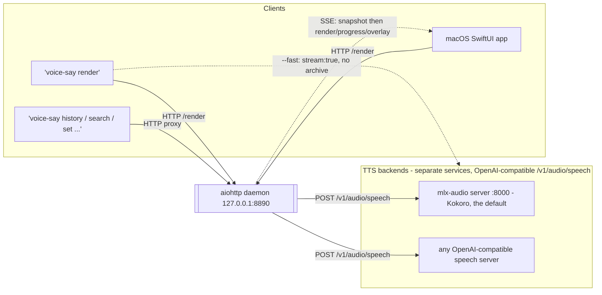
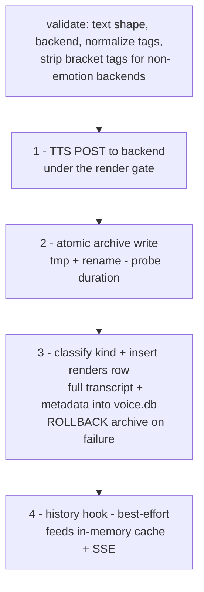

# Architecture

> How the voice-say render pipeline is wired: thin clients funnel through one local aiohttp daemon that owns the entire render contract.

## Overview

voice-say is local-only TTS (no API keys, no cloud). A single Python
**aiohttp daemon** at `127.0.0.1:8890` owns the render pipeline. Every client
surface is a thin proxy onto that daemon:

- the **`voice-say` command line**: `voice-say render` makes and plays audio
  (a bash script), and the other subcommands find, tag, retitle and delete
  library entries (Python, `voice_say.cli`),
- a **macOS SwiftUI app**.

Backends are pluggable HTTP services that each expose an OpenAI-compatible
`POST /v1/audio/speech`. They run as **separate services outside this repo**,
started independently of the daemon:

| backend | endpoint | role |
|---|---|---|
| `kokoro` | `http://127.0.0.1:8000` | Kokoro-82M on mlx-audio's server, the committed default |
| any other | its own `url` | any server that answers `POST /v1/audio/speech` |

The daemon's built-in catalog (`daemon/voice_say/config.py` `DEFAULT_BACKENDS`) ships the one
`kokoro` entry; it is overridden wholesale via `VOICE_SAY_BACKENDS_CONFIG`
(a JSON file) to point at the live catalog on a given machine — see
[Configuration](../setup/configuration.md#your-own-settings-stay-out-of-the-repo) and [backends.md](../setup/backends.md).

Generic defaults: `default_backend = kokoro`, `default_voice = default`.

## Chain



The daemon is the only writer of the archive and `voice.db`. Clients read render
history over HTTP and live updates over Server-Sent Events (see
[sse-and-state.md](sse-and-state.md)); to play a render, the app and
`voice-say render` read the audio file the daemon wrote, by its path or through
`GET /audio/{ts}`.

## The `engine.render()` pipeline (4 steps)

`engine.render()` is the canonical orchestrator. It is **atomic in spirit —
all or nothing** for the two strict artefacts, with explicit rollback on the
database step:



1. **TTS POST.** The text is sent to the chosen backend's `/v1/audio/speech`
   under the render gate (`engine._RenderGate`), two FIFO locks:
   - **tts lock per concurrency key** — one backend request at a time per key.
     All backends on this machine share `__local__` (one model working at a
     time, so two never compete for memory); a backend on another host has its
     own key, so it renders in parallel with the local ones.
   - **episode lock** — one longform render (sequential, stream or resume) at a
     time, so the client's single streaming view is never shared.

   An episode takes the tts lock per chunk, so a short render that arrives
   mid-episode runs after the current chunk, not after the whole episode.
   A request whose client hung up while it queued is dropped (`ClientGone`)
   before it reaches the backend. Transient backend errors are retried twice.
   `/health` reports the queue (`queue.waiting`, `queue.episode_running_s`).
2. **Atomic archive write.** Bytes are written into the dated archive tree
   (`<data_root>/voice-archive/YYYY/MM/<stem>.<ext>`) via tmp-file + rename so
   a crash never leaves a partial file. Then duration is probed once at render
   time so the stored row carries it (no client backfill).
3. **Database insert, with rollback.** The render is classified into a `kind`
   (see below), and the canonical entry — including the **full transcript** —
   is inserted as a row in the `renders` table of the SQLite store `voice.db`.
   The FTS5 index over the transcript is kept in sync. **If the insert fails,
   the archive file is unlinked (rolled back)** and the render fails — the
   two-artefact contract stays consistent.
4. **History hook (best-effort).** A callback feeds the new entry into the
   daemon's in-memory cache, which broadcasts a `render` SSE event. This step
   is best-effort: the strict contract ends at step 3. If the hook raises, the
   render still succeeded on disk; re-raising would 500 the request and cause a
   duplicate render on retry. The hook failure is logged, not propagated.

Errors raise a structured `RenderError` whose `stage` is one of
`tts | request | conflict | archive | db | internal`. The HTTP layer maps stages
to status codes: `tts` → 502, `request` (bad input, including a rejected tag in
closed-vocab mode) → 400, `conflict` (a duplicate of an in-flight op, e.g. a
double-fired episode resume) → 409, local-fs/db stages and `internal` (the
routes' last-resort handler) → 500.

### Longform (streaming) render path

`engine.render()` is the single-shot path; `engine.render_longform()` is a
second, co-equal render path for long text. It chunks the text on
paragraph/sentence boundaries (per-backend chunk ceiling, capped at 40 chunks),
renders the chunks one after another (one tts-lock hold per chunk),
gapless-concatenates them into **one** audio file backed by a **single**
`renders` row — so it is indistinguishable downstream from a normal
`render()`. In `mode="stream"` it broadcasts `episode_start` / `chunk_ready` /
`episode_complete` SSE events (`episode_error` on failure, `episode_cancelled`
on cancel) so a client can play while the rest of the episode is still
rendering. See [sse-and-state.md](sse-and-state.md) for the event shapes.

The chunk ceiling is **per-backend**, not a fixed 1200. The module default is
`LONGFORM_CHUNK_MAX = 1200` (`engine.py`), used only when a backend doesn't
override it; each backend can set `longform_chunk_max` in the backends catalog
and `Backend.chunk_max` resolves the effective value (`self.longform_chunk_max
or LONGFORM_CHUNK_MAX`). A backend that keeps continuity across long input itself
can set a much larger value and render longer chunks with fewer daemon-level
seams. The 40-chunk cap is config-driven
(`longform_max_chunks`, default 40) — a guard against one request tying up the
daemon.

#### Final-chunk-tail preservation

Before concatenation each chunk's leading and trailing silence is trimmed to a
uniform ~210 ms sentence pause, so the gapless join doesn't stack each chunk's
raw tail into a dead-air seam — **except the final chunk, which keeps its
natural tail** (no trailing trim). The last chunk has no following seam, so
trimming its trailing silence would clip the last word's soft decay (a quiet
final consonant/vowel below the silence threshold) — the "last word cut
abruptly" bug. This last-chunk exception applies in both paths: the live
streaming chunks (`engine.py` calls `_sinks.trim_chunk_silence_inplace` with `trailing` off
for the last chunk) and the archive concat (`_sinks.concat_wavs_to_mp3`, through
`_trim_chunk_silence`).

A streaming episode can be finalized early (save-and-stop), which tags the row
`"draft"` and persists a resume boundary (`resume_full_text` /
`resume_char_offset`); `POST /episode/resume` then continues it by re-chunking,
skipping the already-rendered prefix, and merging draft + remainder into one new
row via the same stream path.

### Render `kind`

Every render is classified at render time into a `kind`: `"say"` when
`len(text) <= say_threshold_chars` (default 280), else `"render"`. The `kind`
is stored on the `renders` row alongside the full transcript — nothing is
dropped or excerpted regardless of length. See
[Configuration](../setup/configuration.md) for the `say_threshold_chars` key
and [data-model.md](data-model.md) for the artefact shapes.

## Daemon module layout (route split)

The daemon is split into cohesive modules so handlers stay small and policy
stays in one place:

```
http_server.py     app assembly, lifecycle hooks, request-logging
                   middleware, and the single SSE endpoint
engine.py          render() orchestrator, backend catalog, tag/text policy
state.py           in-memory cache + SSE ring buffer + subscriber plumbing

_routes_render.py  POST /render, POST /render_longform,
                   POST /episode/{id}/cancel, POST /episode/{id}/finalize,
                   POST /episode/{id}/force_finalize,
                   POST /episode/resume
                   (body validation -> engine.render / engine.render_longform)
_routes_meta.py    GET /backends, /voices/{id}, /tags, /stats, /config,
                   /health, POST /config, POST /playback/active,
                   POST /backends/{id}/restart
_routes_history.py GET /history, GET /search (FTS5 over transcripts),
                   GET+POST /progress/{ts}, /overlays/{ts},
                   GET /audio/{ts} (path-traversal guarded), POST /reload,
                   POST /align/{ts}

_validators.py     request-shape helpers (JSON parse, error envelope,
                   stage->status map, typed list/bool/number coercion)
_sinks.py          filesystem sink: archive_write, build_entry, stem(),
                   probe_duration_s
_keys.py           typed aiohttp app keys (shared httpx client + state)
_db.py             SQLite store (voice.db, WAL mode): insert_render + history
                   readers; renders (append-only,
                   full text), progress, overlays, and the renders_fts FTS5
                   virtual table over the transcript
```

The two strict-artefact writers — the audio writer (`archive_write`, `_sinks.py`)
and the DB writer (`insert_render`, `_db.py`) — share the same `stem()` (defined in
`_sinks.py`) so the audio file and the `renders` row agree on one filename per
render. Tag normalization lives in `engine` and is reused by both the `/render`
route and overlay tag edits, keeping validation in lockstep.

## The `voice-say` CLI (thin proxy)

The library CLI (`daemon/voice_say/cli.py`, urllib only) is a **thin proxy** —
it forwards to the daemon over HTTP rather than importing `engine` directly.
The reason is the render gate: two gates in two processes are not one gate,
and a second process holding the database open would be a second writer.
The HTTP hop is cheap; the safety guarantee is not.

Its commands are `health`, `history`, `search`, `tags`, `voices`, `set`
(per-entry title / star / delete / tags / series / episode), `restart` (a
backend's launchd service) and `align` (word timings for the reader). Rendering and
playback stay with `voice-say render`. Playback state (progress, bookmarks) is
intentionally absent — scripts have no business mutating it. Two rules are
checked client-side before any write: `set` validates tags against
`GET /tags`, and `render` checks the title rule against `GET /config`
(`say_threshold_chars`). Start the daemon first; the CLI exits `6` without it.

## Who writes what (shared-DB contract)

This section documents the authority boundary for `voice.db` and the audio
archive.

### The daemon is the sole writer of `voice.db`

Every table write goes through `_db.py` inside the daemon process:

- **renders** — `_db.insert_render()`: append-only, never
  UPDATE/DELETE. Called by `engine.render()` and `engine.render_longform()`
  after a successful TTS + archive write. This is the only path that creates a
  renders row.
- **progress** — `_db.upsert_progress()`: latest-wins UPSERT,
  called by the daemon's `/progress/<ts>` POST handler.
- **overlays** — `_db.upsert_overlay()`: latest-wins UPSERT,
  called by the daemon's `/overlays/<ts>` POST handler
  (`_routes_history.overlays_post`).

No client process opens `voice.db` directly. The macOS app asks for Desktop or
Documents folder access only to play audio files from an archive kept there; it
has no SQLite code, and every read goes through `/history` and the `/events`
SSE stream.

### The macOS app is an HTTP + SSE client that POSTs overlays

The app communicates exclusively through `DaemonClient` (`Services/DaemonClient.swift`),
a URLSession wrapper pointed at `http://127.0.0.1:8890` (or the
`voicesay.daemonURL` override). Its write surface is:

- **Render** — `POST /render_longform` (`renderLongform`): submits
  text + backend/voice params; the daemon owns the full TTS + archive + DB
  pipeline.
- **Overlays** — `POST /overlays/<ts>` (`postOverlay`): stars,
  soft-deletes, tags, bookmarks, and display title. It routes through the daemon's
  `overlays_post` handler (`_routes_history.py`), which calls
  `_db.upsert_overlay()`.
- **Progress** — `POST /progress/<ts>` (`postProgress`): playback
  position ticks. Routes to `_db.upsert_progress()` via the daemon.
- **Episodes** — `POST /episode/{id}/cancel`, `/finalize`, `/force_finalize`
  and `POST /episode/resume`: stop, save or continue a streaming render.
- **Playback** — `POST /playback/active` (`announcePlaybackActive`), so other
  clients pause.
- **Config** — `POST /config` (`setConfig`): daemon-side default backend/voice. Reads back
  via `GET /config`.

The app never writes to the audio archive tree.

### The `voice-say` CLI is a separate process that proxies to the daemon over HTTP

`voice-say` is a separate process (`cli/voice-say` shim, entry point
`voice_say.cli:main`) with its own PID. It imports the `voice_say` package only
for tag normalization and does **not** share the daemon's asyncio event loop or
in-memory state. All reads and writes forward over HTTP to the daemon URL
(`VOICE_SAY_DAEMON_URL`, default `http://127.0.0.1:8890`). The separation is
intentional: sharing the daemon's render gate would require an in-process
import; the HTTP hop is cheap; the shared render-gate guarantee is not.

The CLI has **no direct database access** — every write (overlay) and read
(history, search, tags, voices) routes through the daemon's HTTP API. `set`
fetches `GET /tags` and refuses an unknown tag (exit `4`) before it POSTs
anything. Progress and bookmark mutations are absent from the CLI.

### The CLI is an HTTP client

`cli/voice-say-render` (run as `voice-say render`) is a bash script. It resolves text → JSON payload, then does one
`curl POST` to `$VOICE_SAY_DAEMON_URL/render` or `/render_longform`. It
has no sqlite3 dependency and no filesystem writes beyond the copy it plays
(and `--out`). Title, series and episode ride on that render request; the
daemon writes them through its overlay handler.

### Contract summary

| Surface | voice.db writes | Overlay POSTs | Direct sqlite3 |
|---------|----------------|--------------|----------------|
| Daemon (`_db.py`) | ALL — sole writer | owns handler | yes — WAL, `_lock` guard |
| macOS app | none | via HTTP POST `/overlays/<ts>` | no |
| CLI (`voice-say`) | none | via HTTP POST `/overlays/<ts>` (`set`) | no |
| CLI (`voice-say render`) | none | none (title, series, episode ride on the render request) | no |

Nobody except the daemon process opens `voice.db` for writes.
