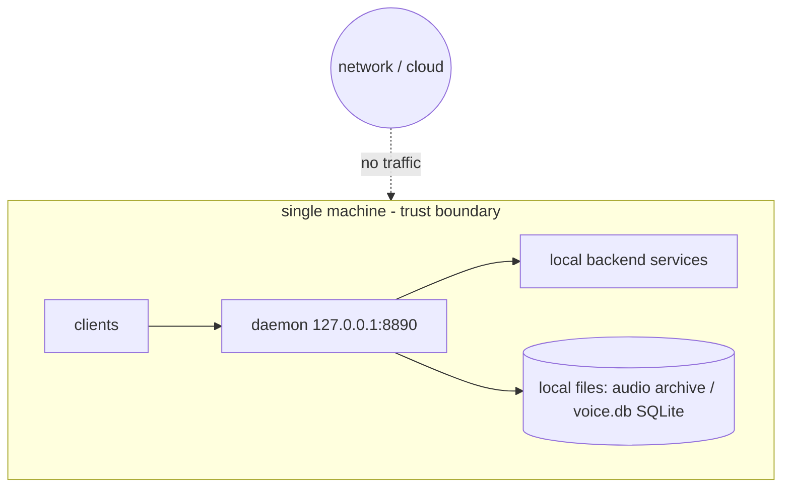

# Security and Safety

> The daemon's safety posture: loopback-only by default, CORS behind an env gate (with the streaming-response caveat), a path-traversal guard on audio, durable SQLite state (atomic audio writes plus a WAL-mode `voice.db`), and only generic defaults in the repo.

## Trust boundary: one machine

voice-say is designed to run **entirely on one machine** — no API keys, no cloud service, no
third-party network calls in the render path. The only network traffic is loopback HTTP between the
daemon and local backends. The model assumes a **single trusted local user**; there is no
authentication layer because there is no remote surface to authenticate.

## No telemetry — nothing leaves the machine

- No analytics, crash reporting, usage pings, or phone-home of any kind.
- No third-party network calls in the render path.
- All artefacts (the audio archive and the `voice.db` SQLite store) are written to local paths you
  control via `data_root`.

> Reporting a vulnerability → top-level [`SECURITY.md`](../../SECURITY.md). Where your own settings
> live → [Configuration](../setup/configuration.md#your-own-settings-stay-out-of-the-repo).

## Loopback-only by default

The daemon binds `127.0.0.1:8890` by default. With no CORS configuration it is
reachable only from the local host — there is no authentication layer because
there is no remote attack surface in the default posture. Binding to a
non-loopback address (`--host 0.0.0.0`) is an explicit, deliberate act and
should only be done on a trusted network.

Loopback alone doesn't stop the browser on the same machine: a web page can
POST a `text/plain` body without a CORS preflight, and DNS rebinding lets a
page read responses under its own hostname. The host guard (`_hostguard.py`)
answers 403 when the `Host` header is not localhost, a loopback or Tailscale IP
literal, or a `*.ts.net` name, and when a POST carries an `Origin` that is not
loopback, not the request's own host, and not the configured `cors_origins`.
A page on another tailnet name is refused: anyone can publish a `*.ts.net`
page with Tailscale Funnel. A page served from loopback itself (a local dev
server on `localhost:3000`, say) counts as loopback and can write. The `voice-say`
command line and the app send no `Origin` and are unaffected.

The guard is a browser defence only. The daemon has no authentication: any
program that reaches its port can read and write everything. On a shared Mac,
other local users can reach `127.0.0.1` too. Behind `--host 0.0.0.0` the guard
still refuses a LAN address in `Host`, but on a tailnet address or behind
`tailscale serve` every peer on the tailnet can.

## CORS is env-gated

Cross-origin access is **off unless `cors_origins` is set**. When unset (the
default), browsers can't read cross-origin responses. `cors_origins`
takes a **single** verbatim origin string, emitted directly as the
`Access-Control-Allow-Origin` header — it is one origin, not a comma-separated
list or multi-origin allow-list. Setting it opts in exactly one cross-origin
browser caller (this hook is dormant unless you configure it). Leaving it unset
is the safe default. `*` would let every web page you open read the whole
library (transcripts and audio), so the daemon refuses to start with `*`, a
list or a comma-separated value there.

## Shared Macs

voice-say assumes one user per Mac: the daemon on `127.0.0.1` answers every
local user. The CLI player's control socket (`voice-mpv.sock`), its pid and
last-path files, the CLI logs and the app's socket (`voice-sayapp.sock`) sit in
the per-user temp dir (`$TMPDIR`, mode 0700 on macOS, the folder the app finds
with `NSTemporaryDirectory()`), not the shared `/tmp`, so another user cannot
plant them. `voice-ctl stop` only kills a pid that is an mpv.

### Streaming-response CORS caveat

CORS headers for ordinary JSON responses can be attached by middleware after the
handler returns. **Streaming responses cannot.** The SSE endpoint (`/events`)
and the `/audio/{ts}` file response both commit their headers at
**response-prepare** time — once the stream is prepared, the header block is on
the wire and can no longer be amended. Therefore any CORS headers for these
endpoints must be applied **on response-prepare**, not in a trailing middleware.
A CORS layer that only post-processes buffered responses will silently fail to
mark SSE and file responses cross-origin-readable.

## `/audio` path-traversal guard

`GET /audio/{ts}` serves the mp3 for a render by looking up the entry's
`archive_path`. Before streaming, the daemon **resolves** the path and asserts
it lives **inside the archive root**:

- resolved path is checked with `relative_to(ARCHIVE_ROOT)`;
- if it escapes the root, the request is refused with **403** (`archive_path
  escapes ARCHIVE_ROOT`);
- a missing-on-disk file is **404**, not a directory listing or error leak.

This defends against a maliciously-seeded or corrupted entry whose
`archive_path` points at something like a system password file. The guard
trusts the archive root, not the stored path.

## Atomic audio writes + durable SQLite state

Each render produces **two artefacts**, and each is written durably:

- the audio archive is written **tmp-file + rename** — write `.tmp`, then
  `replace()` — so a `SIGKILL` mid-write never leaves a partial or torn file
  under `voice-archive/`;
- all state (the full transcript plus every metadata field) lands in a single
  SQLite store, `voice.db` at `<data_root>/voice.db`, opened in **WAL mode**.

`voice.db` holds the `renders` table (append-only, including the full `text`),
the `progress` and `overlays` tables, and the `renders_fts` FTS5 virtual table
over the transcript. WAL mode gives crash-safe, concurrent-reader durability:
writes commit atomically and a reader never sees a half-applied row. SQLite
owns the write/lock/recovery semantics. A torn or aborted write can never corrupt history
or playback.

## Nothing personal in the repo

Committed files carry only generic defaults (`default_backend = kokoro`,
`default_voice = default`, `./data` for the data root) and no secrets. Your own
paths, voices and backends live in files git ignores (`config.local.toml`, a
backend catalog named by `VOICE_SAY_BACKENDS_CONFIG`), and your LaunchAgents in
`~/Library/LaunchAgents/`; see
[Configuration](../setup/configuration.md#your-own-settings-stay-out-of-the-repo).
On the public repository, GitHub secret scanning and push protection catch a
credential pushed by mistake, and a contribution needs `make test` passing
(see [CONTRIBUTING.md](../../CONTRIBUTING.md)).
