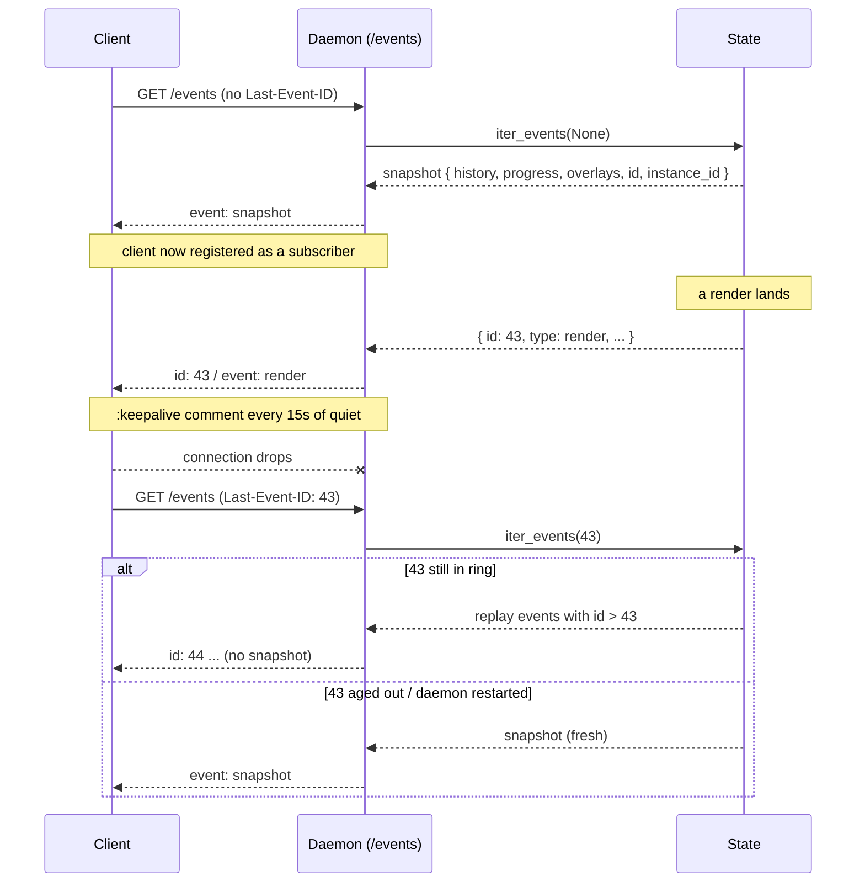

# SSE and In-Memory State

> How the daemon serves live updates: a single in-memory cache projects the SQLite store, a bounded ring buffer backs Server-Sent Events, and reconnects replay from the ring or fall back to a fresh snapshot.

## The in-memory `State` cache

The daemon is single-process and single-writer — only the daemon mutates the
SQLite store (`voice.db`, WAL mode) — so reads are served from RAM with no
concurrency gymnastics. The `renders`/`progress`/`overlays` tables remain the
durability layer; the cache is purely the read-side projection.

`State` holds three caches plus the SSE plumbing:

- `history` — `ts → entry`, insertion-ordered (newest-last; reverse for
  newest-first).
- `progress` — `ts → latest progress row`, last-write-wins.
- `overlays` — `ts → latest overlay row`, last-write-wins.
- `event_seq` + `ring` — a monotonically increasing event id and a bounded
  buffer of recent events.
- `subscribers` — the set of live SSE subscriber queues.
- `instance_id` — a per-process random tag (see reconnect, below).

At startup the cache hydrates once from the database. After that, every write
path goes through a hook (`record_history` / `record_progress` /
`record_overlay`) that updates the cache **after** the row commits to SQLite
and then broadcasts the corresponding SSE event (`render` / `progress` /
`overlay`). Reads never touch the database.

## The 256-event ring buffer

`_broadcast()` assigns each event the next `event_seq`, appends it to a
`deque(maxlen=256)`, and fans it out to every subscriber queue. The ring is the
short-term replay window for reconnecting clients: anything still in the ring
can be replayed exactly; anything older is gone and the client must take a
fresh snapshot instead.

## Connect → snapshot → events

On `GET /events` the daemon reads an optional `Last-Event-ID` header, then asks
`State.iter_events()` for the correct opening sequence. The handler is a thin
wire-format adapter; all snapshot/backlog/register ordering is enforced once,
inside `iter_events`.

A **fresh** connection (no `Last-Event-ID`) gets a single `snapshot` event —
the full current `history` (newest-first), `progress`, and `overlays`, plus the
current `event_seq` and `instance_id` — and then receives live events as they
arrive.

## SSE event vocabulary

The full set of event types a subscriber can see:

- `snapshot` — the opening event on a fresh connection (full `history`,
  `progress`, `overlays`, plus `event_seq` and `instance_id`).
- `render` — a finished render landed a row in `renders`.
- `progress` — a `progress` row was written (last-write-wins).
- `overlay` — an `overlay` row was written (last-write-wins).
- `reloaded` — the cache was re-hydrated out-of-band (see `POST /reload`).

These five are the cache-backed events: each `render`/`progress`/`overlay`
corresponds to a committed row, and `snapshot`/`reloaded` project the whole
cache.

A second family covers **streaming (progressive) renders**, emitted by
`render_longform` when invoked in `mode="stream"`:

- `episode_start` — once, before the chunk loop, no row exists yet.
- `chunk_ready` — per rendered chunk (carries a cumulative audio-seconds head).
- `episode_complete` — terminal success marker, fired **after** the canonical
  `render` event so the single `renders` row is already live when it lands.
- `episode_error` — terminal failure marker, emitted in place of
  `episode_complete` when a chunk render raises.
- `episode_cancelled` — terminal marker when the episode is cancelled mid-run.

The `episode_*` events are **ephemeral broadcasts**: they ride
`State.broadcast` directly and write no cache row, so they appear live and in
the ring but never in a `snapshot`. The durable result of a streaming render is
still the one canonical `render` event (and its `renders` row); the `episode_*`
events are progress/lifecycle signals layered on top for clients that want to
follow a long render as it builds.

One more event rides the same ephemeral `State.broadcast` path:

- `playback_active` — emitted by `POST /playback/active` so other surfaces can
  pause and avoid doubled audio. Carries `source` (the surface that claimed
  playback — `voicesay` from the macOS app, `cli` from `voice-say render`'s mpv) and
  `ts`. Like the `episode_*` events it lands in the ring but never in a
  `snapshot`, and writes no cache row.

`POST /episode/resume` (continue a save-and-stop draft) reuses this **exact
same** `episode_start` / `chunk_ready` / `episode_complete` contract as a fresh
stream render — it calls the streaming render wholesale, so a client following
a resume is indistinguishable from one following an original stream. Two details
differ in payload, not in shape:

- `episode_start.text` carries the **full joined text**, including the
  already-rendered prefix from the draft, so the client can gray out the
  rendered portion up to the render-head and show the remainder pending.
- `rendered_chars` (the per-chunk render-head on `chunk_ready`) **starts at the
  draft's stored resume offset** rather than at 0, since the leading chunks are
  skipped and only the remainder is rendered. The offset is a clean per-chunk
  seam, so the head stays in full-text space.
- `episode_start.prefix_audio_s` carries the **audio seconds already in the draft
  prefix**. The prefix mp3 is concatenated server-side, never streamed as
  `chunk_ready`, so without this the client's seconds-based render-head + play-head
  would start at 0 while `predicted_total_s` covers the whole text — the live
  progress bar would under-fill by the prefix fraction. The client seeds both heads
  with `prefix_audio_s` so they read against the whole-episode duration. `0.0` on a
  fresh render.

`POST /episode/{id}/force_finalize` is `finalize`'s impatient sibling: it keeps the
completed chunks as the `"draft"` row but cancels and drops the in-flight chunk's
synth instead of awaiting it, so a long final chunk can't strand a client on the
"wrapping up" state. The render's in-flight-chunk `CancelledError` handler tells a
force-finalize (keep what's done) apart from a plain cancel (discard everything) via
the registry's `force` flag; with no chunk completed yet it falls back to a cancel.

Optionally, the SSE drives the client's status phases: *Preparing →
Rendering chunk K of N → Finishing up → Wrapping up*.

## Last-Event-ID reconnect

When a client reconnects with `Last-Event-ID: N`, `iter_events` decides between
replay and a fresh snapshot:

- **Replay from ring** — if `N` is still within the ring, yield exactly the
  buffered events with `id > N`, then continue live. No snapshot is sent.
- **Fresh snapshot** — sent when any of:
  1. there is no `Last-Event-ID` (first connect);
  2. `N` has aged out of the ring (the missed backlog is gone);
  3. `N > event_seq` — the client is "impossibly ahead." This happens after a
     daemon restart resets `event_seq` to 0 while the client still holds a
     pre-restart id. Without this branch the daemon would return an empty
     backlog, skip the snapshot, and the client would sit on dead air until the
     next broadcast.

Branch 3 alone does not cover a restart: once the new process has broadcast
`N` or more events, a pre-restart `N` looks valid and the replay skips the new
process's first `N` events. So the SSE `id:` line is `<instance_id>-<seq>`
(`State.wire_event_id`), and `State.parse_last_event_id` maps a
`Last-Event-ID` whose instance is not this process's to "send a snapshot". A
bare integer is still read as a seq of the running process.

Ordering guarantee: the backlog/snapshot is computed and the subscriber queue
is registered **as a synchronous pair**. asyncio's single-threaded loop
guarantees no `_broadcast` interleaves between them, so an in-flight event lands
either in the ring (and is replayed) or in the queue — never both. This avoids
double delivery.

## Keepalive cadence

When quiet, `iter_events` yields `None` every `keepalive_s` (15s) and the
handler writes a `:keepalive\n\n` SSE comment. Some HTTP client stacks buffer
small chunks until enough bytes accumulate; without periodic ticks a render or
overlay event could sit in the client's read buffer for tens of seconds before
the UI sees it. The keepalive forces a flush.

## Slow-subscriber handling (drain + drop sentinel)

Each subscriber has a bounded queue (size 64). On broadcast, `put_nowait` to a
full queue means that consumer has fallen behind. The daemon then:

1. removes the queue from `subscribers`,
2. **drains** any buffered events still in the queue,
3. pushes a private `_DROP` sentinel.

The subscriber's `iter_events` loop wakes on its next `get()`, sees `_DROP`, and
**returns cleanly** — the SSE handler unwinds and closes the connection. The
drain is essential: a full queue would reject the sentinel via `put_nowait`,
and a stuck consumer that had drained its buffer would otherwise hang forever
on `get()`, leaking the coroutine and the connection. Drain-then-sentinel
guarantees the slow consumer is released rather than parked.

## `POST /reload` escape hatch

If an external process writes to `voice.db` out-of-band (e.g. a chunked-render
queue or a manual edit), `POST /reload` re-hydrates the cache from the database
— clearing `history` so rows deleted from the store don't linger — and
broadcasts a `reloaded` event so subscribers can refresh without a daemon
restart.
