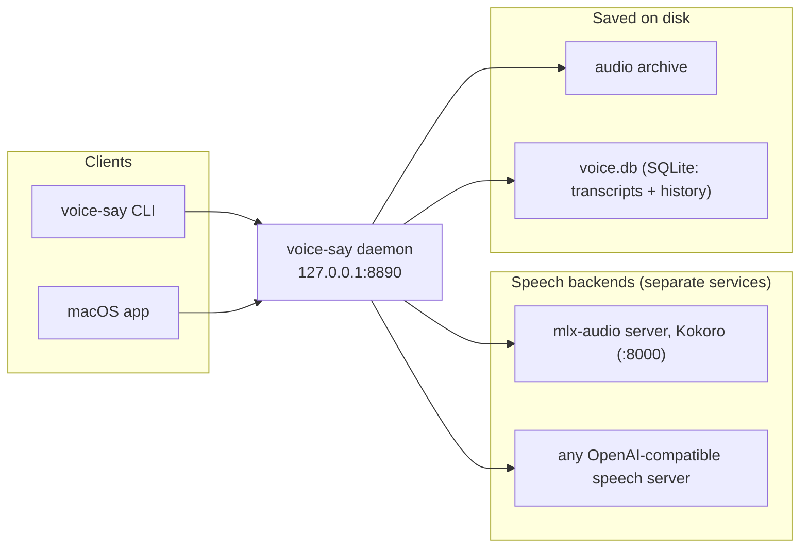

# voice-say — Product Overview

Local-only text-to-speech: turn any text into spoken audio, entirely on your own machine.

## What voice-say is

voice-say is a small, self-contained text-to-speech system that runs completely on your computer — no cloud calls, no API keys, nothing leaves the machine. You hand it text, it renders that text to an audio file with a local speech engine and plays it back, and it keeps a tidy on-disk archive of everything it has spoken so you can find and replay it later. A single background service — the **daemon** — owns the whole render pipeline, and two thin front ends talk to it through one shared contract: the **command-line tool**, `voice-say` (`voice-say render` makes audio, the other commands work the library), and a **macOS app**. Because there is exactly one render path behind every surface, the saved files stay consistent no matter how you asked for the audio.

## The problem it solves

Cloud text-to-speech is convenient but it comes with three standing costs:

- **Privacy exposure.** Your text — notes, drafts, private messages, an agent's reasoning — is sent to a third-party server to be synthesized.
- **Per-character cost.** Most hosted voices bill by the character, so longform narration and frequent use add up, and pricing can change under you.
- **Vendor lock-in.** Your voices, your render history, and the audio itself live inside someone else's account and API.

voice-say removes all three by running the whole pipeline locally. Synthesis happens on your hardware, so text never leaves the machine; there is nothing to meter, so it is free to run once installed; and every artefact — the audio file on disk and the full transcript with its metadata in a local database — is written to your own machine in open formats. The output is yours.

## What it's used for

A few jobs it does well:

- A **scriptable, local TTS endpoint** with a clean HTTP and CLI contract.
- **Wiring spoken output** into local tools and pipelines.
- **Keeping text off the cloud** — synthesis stays on the machine.
- **Giving local agents and scripts a voice** by calling the `voice-say` command.

## Core capabilities

- **Local text-to-speech via swappable backends.** The daemon talks to pluggable speech backends over a shared OpenAI-compatible `POST /v1/audio/speech` contract, run as separate services outside this repo. The default is Kokoro on mlx-audio's server (port `8000`); any other server that speaks the contract is a two-field catalog entry (`url`, `model`). A backend that interprets inline `[emotion]` tags declares it; for the rest the daemon strips `[bracket]` tags before synthesis.
- **One engine, two front ends.** Every client funnels through the same daemon: the **CLI** (`voice-say`) and the **macOS app**. No surface bypasses the render path.
- **Render history, full transcripts, and tags.** Each render writes exactly two artefacts: a permanent audio file in the archive, and a row in a single local SQLite store (`voice.db`) that holds the **full transcript** plus all metadata (timestamp, backend, voice, format, character count, duration, byte size, archive path, and tags). Tags use an open vocabulary: any normalized tag is accepted and `GET /tags` lists what is in use. You can also star, bookmark, and soft-delete entries.
- **Read along, and listen while it renders.** The macOS app includes a full-screen transcript reader that highlights text in step with playback and auto-scrolls; for longer pieces, playback can begin while the audio is still rendering. You can also stop a long render early and keep what's finished as a draft, then resume it later to render the rest — handy for previewing a long narration before committing to the full render.
- **Says vs. renders.** Every render is classified at render time into a **kind**: short text is a `say` (a status ping or brief utterance) and longer text is a `render`, with the app surfacing "says" as a built-in category so quick spoken pings stay separate from longform narration. See [Configuration](../setup/configuration.md) for the exact `say_threshold_chars` rule.
- **Full-text transcript search.** Because the complete transcript lives in the database, you can search across everything you have spoken: `GET /search?q=<query>&limit=<n>` runs full-text search (FTS5) over transcripts, newest-first, returning the same shape as the history endpoint. The macOS app exposes the same capability.
- **Plug-and-play setup.** `make setup` prepares the local Python environment and installs the CLI on your PATH; `make kokoro` installs the default backend and `make kokoro-run` starts it; `make run` then starts the daemon (see [Backends](../setup/backends.md)). Generic defaults give you working speech with zero edits once a backend is up.
- **Config-driven.** Behavior — chosen backend and voice, archive location, the say/render threshold, the tag vocabulary, CORS origins — is driven by configuration rather than code edits. The configuration layer has `env > config.local.toml > config.example.toml` precedence; the daemon reads its settings and exposes them to clients via `GET /config`.

## How it fits together

## What sets it apart

- **Local-only, no API keys.** The daemon binds to loopback (`127.0.0.1:8890`) by default; synthesis runs on your machine and text never leaves it. There are no accounts and nothing to authenticate against a cloud.
- **One engine, one render contract.** The CLI and the macOS app are thin clients over the same daemon, so a render done one way is identical to a render done another way — same archive, same history, same rules.
- **Open formats, your settings kept apart.** Artefacts are written to your own disk in open formats — audio files alongside a single SQLite database you can query directly. The repository holds only generic defaults; your paths, voices and backends live in local files git ignores (see [Configuration](../setup/configuration.md#your-own-settings-stay-out-of-the-repo)).
- **Customizable without code.** Voices, backend choice, the archive location, the say/render threshold, the tag vocabulary, and access settings are configuration, not source edits.
