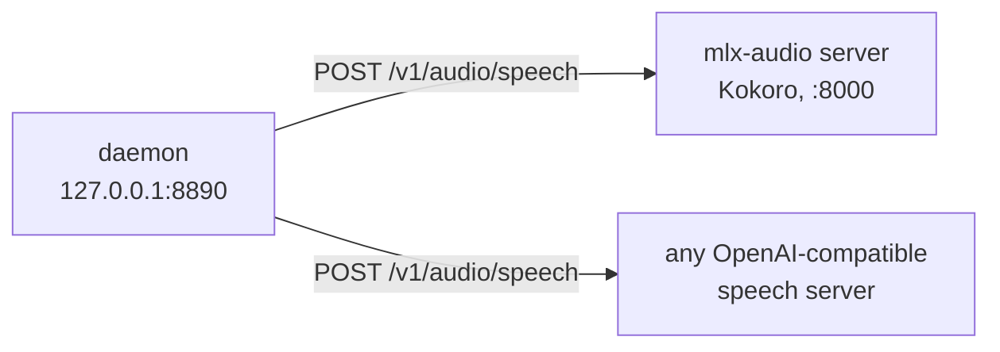
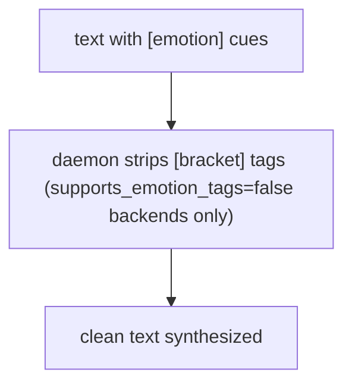

# Backends

The TTS backends behind voice-say: the default (Kokoro on mlx-audio), how to add any
OpenAI-compatible speech server, the catalog fields, and inline `[emotion]` tag handling.

A **backend** is a local HTTP service that turns text into audio. The daemon does
not synthesize audio itself — it proxies to whichever backend a render names (or
the configured `default_backend`). Backends are **separate services that run
outside this repo**; the daemon only knows how to reach them.

## The speech contract

Every backend answers the OpenAI-compatible text-to-speech endpoint:

```
POST /v1/audio/speech   {"model": "...", "input": "...", "voice": "...", "response_format": "wav"}
```

The daemon sends the text, model, voice and format; the backend returns audio bytes.
Optionally it also lists its voices at `GET /v1/audio/voices?model=...`
(`{"data": [{"id": "af_heart"}, …]}`), which mlx-audio's server does.



## The default: Kokoro on mlx-audio

The committed catalog (`daemon/voice_say/config.py` `DEFAULT_BACKENDS`) has one entry,
`kokoro`: [Kokoro-82M](https://huggingface.co/hexgrad/Kokoro-82M) (Apache-2.0) served by
[mlx-audio](https://github.com/Blaizzy/mlx-audio)'s server on Apple Silicon.
`make kokoro` runs the lines below (pinned to the versions measured together:
mlx-audio 0.6.1, misaki 0.9.4); `make kokoro-run` starts the server.

```sh
python3.12 -m venv ~/.venvs/mlx-audio   # misaki needs Python < 3.13
~/.venvs/mlx-audio/bin/pip install "mlx-audio[server]==0.6.1" "misaki[en]==0.9.4"
# macOS: the espeak-ng library that misaki loads (the espeakng-loader wheel, 0.2.3
# and 0.2.4) exits the server on the first render with "Error processing file
# '.../espeak-ng-data/phontab'" (a path from the wheel's build machine). Use Homebrew's instead:
brew install espeak-ng
ln -sf "$(brew --prefix)/lib/libespeak-ng.dylib" \
  "$(~/.venvs/mlx-audio/bin/python -c 'import espeakng_loader as e; print(e.get_library_path())')"
~/.venvs/mlx-audio/bin/python -m mlx_audio.server --host 127.0.0.1 --port 8000
```

`misaki` is Kokoro's text-to-phoneme step; `mlx-audio[server]` does not pull it in.
The first render downloads the model from Hugging Face (689 MB with its voice packs);
loading it takes ~8 s on an M2 Pro (16 GB), then under a second for a short line. Voices (`af_heart`,
`bm_george`, …) come from the server; `voice-say voices kokoro` lists them.

## Adding a backend

Point `VOICE_SAY_BACKENDS_CONFIG` at a JSON file. It **replaces** the committed catalog,
so list every backend you want. An entry needs two fields:

```json
{
  "kokoro": {"url": "http://127.0.0.1:8000", "model": "mlx-community/Kokoro-82M-bf16"},
  "my-tts": {"url": "http://127.0.0.1:9000", "model": "tts-1"}
}
```

```sh
VOICE_SAY_BACKENDS_CONFIG=$(pwd)/my-backends.json make run
voice-say render --backend=my-tts "hello"
```

The other fields are optional:

| Field | Default | Meaning |
|---|---|---|
| `url` | — | Base URL of the server (`http://host:port`; a trailing `/v1` is dropped). Older entries may give `host` + `port` instead. |
| `model` | `tts-1` | Sent as the OpenAI `model` field, so one server can serve several models. |
| `voices` | asked from the server | The voice list for pickers. Leave it out and the daemon asks `GET /v1/audio/voices?model=`; give `[]` for a server that has no list. Not an allowlist: any voice passes through. |
| `default_voice` | `default` | Voice when the caller names none; `default` sends no voice field. |
| `label` | the id | Display name. |
| `output_format` | `mp3` | `mp3` or `wav`, what the server returns (mlx-audio needs ffmpeg for mp3, so `kokoro` uses `wav`). |
| `supports_speed` | `false` | Forward `--speed`. |
| `supports_emotion_tags` | `false` | Keep inline `[emotion]` / `<|…|>` tags; otherwise the daemon strips them. |
| `timeout_s` | `600` | Per-request timeout. |
| `longform_chunk_max` | `0` | Characters per request for long text; `0` = the global ~1200. A backend that carries continuity across its own seams sets it larger. |
| `service` | none | `{"kind": "launchd", "label": "..."}` lets the app start/stop it and `voice-say restart` restart it. |
| `accent` | grey | Hex colour in the app. |

`longform_max_chunks` (the cap on the *number* of chunks per render, default 40) is a
daemon setting, see [configuration.md](./configuration.md).

## Inline `[emotion]` tags

Text may contain inline emotion cues in square brackets, e.g.
`[calm] ... [excited] ...`.

- For any backend whose `supports_emotion_tags` is **false** (e.g. `kokoro`), the
  daemon **strips** every tag (a bracketed word or phrase on its own, like `[whisper]`)
  before synthesis, so the cues never reach the backend and never appear in audio.
  Brackets that are part of the text (`[1]`, `arr[0]`, `[word](link)`) and
  paragraph breaks stay.
- A backend whose model reads such cues sets `supports_emotion_tags = true`. For it the daemon leaves the
  inline `[bracket]`/`<angle>` cues **in the text** so the model can act on them; they are not
  stripped.



This means tag-bearing input sent to a non-expressive backend is always safe: the
bracketed cues are removed and only clean spoken text is rendered. Sent to a backend with
`supports_emotion_tags = true`, the cues are passed through to the model.

### Private voice overlay (e.g. a cloned voice)

The public catalog ships only generic, redistributable entries. To use a
**private cloned voice** (a personal voice clone you do not want to publish),
keep it out of git entirely and inject it at runtime via the same override:

1. Stand up your cloned-voice backend on its port.
2. Write a `backends.local.json` that remaps the relevant backend's `voices`
   (and `default_voice`) to include your clone, e.g. `"voices": ["my_clone", …]`.
   This file matches the gitignore (`backends.local.json`, `*.private.json`) so
   it is never committed.
3. Point the daemon at it: `VOICE_SAY_BACKENDS_CONFIG=…/backends.local.json` (set
   it in the daemon's LaunchAgent `EnvironmentVariables`, or your shell).

The clone now appears in the CLI and macOS-app voice pickers on your
machine only. Nothing about it (model files, voice ids, deployment host) lives
in the tracked core. Do **not** add private voices to `config.py`
`DEFAULT_BACKENDS`.

The backend protocol is OpenAI's `/v1/audio/speech` shape:

```jsonc
POST <backend>/v1/audio/speech
{
  "model": "tts-1",
  "input": "the text to speak",
  "voice": "voice-id",           // optional — daemon omits when "default"
  "response_format": "wav",
  "speed": 1.0                    // optional, only if supports_speed=true
}
→ HTTP 200, body = audio bytes
```

Plus a `GET /v1/audio/voices` endpoint returning a JSON array or
`{voices: [...]}` listing available voice ids.

## Inspecting backends at runtime

```sh
curl http://127.0.0.1:8890/backends          # configured backends
curl http://127.0.0.1:8890/voices/kokoro     # voices for a backend
curl 'http://127.0.0.1:8890/health?deep=1'   # deep probe incl. backend reachability
```

## Performance notes

- Render concurrency: a **per-backend render gate** (`engine._gated()`) serializes
  renders to the *same* backend (max 1 per gate key) while letting renders to
  *different* backends run concurrently — two requests to one backend queue;
  requests to two distinct backends proceed in parallel.
- Per-backend timeout: configurable per entry in the catalog (`timeout_s`). The
  default is 600 s — raise it for a slow model or long chunks.

See [configuration.md](./configuration.md) for `default_backend` / `default_voice`
and [customization.md](./customization.md) for per-render overrides.
