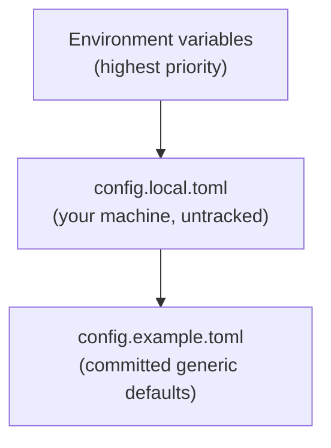

# Configuration

The full configuration reference: precedence chain, every key with its default and meaning, an annotated `config.local.toml`, and the equivalent environment variables.

## Precedence chain

Settings resolve from highest to lowest priority:



- **Environment variables** override everything. Useful for per-launch overrides
  and for a LaunchAgent's settings.
- **`config.local.toml`** is your machine-local file (untracked). Put your edits
  here. If it can't be parsed, the daemon refuses to start and names the line,
  and a Settings save answers 409 instead of overwriting it.
- **`config.example.toml`** holds the committed generic defaults. Treat it as
  read-only documentation of the defaults; copy it to `config.local.toml` to edit.

## Key reference

| Key | Default | Meaning |
|---|---|---|
| `data_root` | `./data` (committed default, so `daemon/data`: a relative path counts from the config file's directory, or from the shell's for `VOICE_SAY_DATA_ROOT`; the in-code fallback when no TOML is present is `~/.local/share/voice-say`) | Where the permanent audio archive and the `voice.db` SQLite store live. |
| `default_backend` | `kokoro` | Backend used when a render does not name one. Writable at runtime — see below. |
| `default_voice` | `default` | Voice used when a render does not name one (`default` = the backend picks its own). Writable at runtime — see below. |
| `say_threshold_chars` | `280` | Renders with `chars <= say_threshold_chars` are classified as `kind="say"` (short utterances/status pings); longer renders are `kind="render"`. |
| `allowed_tags` | `[]` | Tag vocabulary. **Empty = open vocabulary (any tag allowed).** Populate to close the vocabulary. |
| `daemon_port` | `8890` | Loopback port the daemon binds. |
| `max_render_chars` | `200000` | Hard upper bound on a single render's input length. Read at startup (restart the daemon after changing it; `/reload` doesn't re-read it). |
| `longform_max_chunks` | `40` | Max chunks per single longform render. A self-DoS guard for the HTTP surface. The chars-per-chunk ceiling is **per-backend** (`longform_chunk_max` in the backends catalog; a backend that splits and joins long input itself may set it higher), anything without a value falls back to the global default `1200`. So total input capacity varies by backend. |
| `cors_origins` | *unset* | Allowed CORS origins. **Unset = loopback only** (no cross-origin access). |
| `align` | `true` | Read-along word timings, measured from each render's audio by macOS's on-device speech recognizer (the helper `make setup` builds on macOS 26). Off when `false` or when the helper is not built. Runs only while no render is in progress. |
| `align_locale` | `en-US` | Language the recognizer listens for when aligning. |
| `align_min_s` | `15` | Renders shorter than this many seconds are not aligned; the reader keeps an even pace for them. |
| `[pronounce]` | *empty table* | Words the voice mispronounces: written form → how to say it (`Siobhan = "Shiv-awn"`). Applied to the text sent to the backend only (whole words, case-sensitive); the stored transcript keeps the written form. |

### Changing default_backend / default_voice at runtime

`default_backend` and `default_voice` can be changed live — no restart, no
hand-editing TOML. The VoiceSay macOS app's **Settings → Default backend /
Default voice** pickers do this; under the hood they `POST /config`:

```sh
curl -X POST http://127.0.0.1:8890/config \
  -H 'Content-Type: application/json' \
  -d '{"default_backend":"kokoro","default_voice":"af_heart"}'
```

The daemon validates the choice against the live backend catalog, persists it
to `config.local.toml`, and live-reloads — so every surface (the `voice-say`
CLI, the macOS app) honors the new default immediately. Pass
`"default_voice": ""` to clear it (the backend then picks its own default).

> **Caveat:** environment variables win over the written TOML. If
> `VOICE_SAY_DEFAULT_BACKEND` / `VOICE_SAY_DEFAULT_VOICE` are set (e.g. in the
> daemon's LaunchAgent), the written value is shadowed and `POST /config`
> returns a `warnings` entry saying so. Leave those env vars unset to make the
> Settings pickers authoritative.

### Notes on individual keys

- **`data_root`** holds two permanent layers: the audio archive
  (`voice-archive/YYYY/MM/<stem>.<ext>`, referenced by `archive_path`) and the
  `voice.db` SQLite store (at `<data_root>/voice.db`, WAL mode). `voice.db` holds
  the `renders` table (append-only, including the full `text` transcript), the
  `progress` table (playback memory), the `overlays` table (star / tags /
  bookmarks / soft-delete), and the `renders_fts` FTS5 virtual table over the
  transcript.
- **`say_threshold_chars`** classifies every render at render time into a `kind`:
  `kind="say"` when `chars <= say_threshold_chars` (short utterances / status
  pings, surfaced as a built-in category in the app), else `kind="render"`. It is
  purely a classification threshold — every render is stored fully in `voice.db`
  regardless.
- **`allowed_tags`** defaults to `[]` (open vocabulary). Set it to a non-empty
  list to close the vocabulary: `POST /render` will then reject unknown tags with
  HTTP 400. Leave it empty to accept any tag freely. See [customization.md](./customization.md).
- **`cors_origins`** stays unset for a loopback-only deployment. It is an
  optional, off-by-default mechanism: set it only if you have a real
  cross-origin consumer to serve. Never `*`: every web page you open could
  then read your whole library (transcripts and audio). See [customization.md](./customization.md).
- **Seam silence** (not a setting) — a longform render is split into
  chunks, each rendered to WAV and gapless-concatenated into one mp3. Each
  chunk's leading and trailing silence is trimmed to a uniform inter-chunk
  sentence pause so seams don't stack dead air. The **final** chunk is an
  exception: its trailing silence is *not* trimmed, preserving the last word's
  natural soft decay (without this, the last word is clipped — the "last word
  cut abruptly" artifact). This applies to both the sequential concat and the
  streaming play-while-rendering path. Each seam is then padded with room
  tone up to a paragraph pause (0.53 s). `longform_max_chunks` only caps how
  many chunks one render may have.

## Annotated `config.local.toml`

Copy `config.example.toml` to `config.local.toml` and edit. A complete annotated
example:

```toml
# config.local.toml — machine-local overrides (do not commit).

# Where the audio archive + voice.db SQLite store live.
data_root = "./data"

# Default backend + voice used when a render does not specify them.
default_backend = "kokoro"
default_voice   = "default"

# Renders with chars <= this are classified kind="say" (short utterances);
# longer renders are kind="render". Classification only — all renders are stored.
say_threshold_chars = 280

# Tag vocabulary. Empty list = open vocabulary (any tag allowed).
# To close the vocabulary, add tags here:
# allowed_tags = ["summary", "narration", "note"]
allowed_tags = []

# Loopback port the daemon binds.
daemon_port = 8890

# Hard cap on a single render's input length.
max_render_chars = 200000

# CORS origins. Leave commented out for loopback-only (recommended).
# cors_origins = "http://127.0.0.1:5173"

# Read-along alignment (macOS 26; helper built by `make setup`).
align = true
align_locale = "en-US"
align_min_s = 15

# Pronunciation fixes: written form = how the voice should say it.
[pronounce]
# Siobhan = "Shiv-awn"
```

## Equivalent environment variables

A subset of keys can be overridden via environment variables (the **`VOICE_SAY_`**
prefix). Env wins over both TOML files — useful for per-launch
overrides. The remaining keys are **TOML-only** (`max_render_chars`,
`allowed_tags`, `align_locale`, `align_min_s`, `[pronounce]`) — set those in `config.local.toml`.

| Config key | Environment variable | Example value |
|---|---|---|
| `data_root` | `VOICE_SAY_DATA_ROOT` | `~/.local/share/voice-say` |
| `default_backend` | `VOICE_SAY_DEFAULT_BACKEND` | `kokoro` |
| `default_voice` | `VOICE_SAY_DEFAULT_VOICE` | `default` |
| `say_threshold_chars` | `VOICE_SAY_SAY_THRESHOLD_CHARS` | `280` |
| `longform_max_chunks` | `VOICE_SAY_LONGFORM_MAX_CHUNKS` | `40` |
| `daemon_port` | `VOICE_SAY_PORT` | `8890` |
| `cors_origins` | `VOICE_SAY_CORS` | `http://127.0.0.1:5173` (one origin; never `*`) |
| `align` | `VOICE_SAY_ALIGN` | `0` (off) |

Additional env-only settings (no TOML key):

| Variable | Purpose |
|---|---|
| `VOICE_SAY_CONFIG` | Path to a `config.local.toml` overlay (else found beside `config.example.toml`). |
| `VOICE_SAY_BACKENDS_CONFIG` | Path to a JSON file that **replaces** the backend catalog — ports, voices, `output_format`. See [backends.md](./backends.md). |
| `VOICE_SAY_DAEMON_URL` | URL the `voice-say` command line uses to reach the daemon (default `http://127.0.0.1:8890`). It reads only this, not `config.local.toml`: after changing `daemon_port`, set it too. |

### A daemon on another port

After changing `daemon_port`, point the clients at it too. The `voice-say` command line reads
`VOICE_SAY_DAEMON_URL` (above). The macOS app reads its daemon address once at launch:

```sh
defaults write local.voicesay.VoiceSay voicesay.daemonURL http://127.0.0.1:<port>
```

then reopen the app. The app must run on the same machine as the daemon, because it
plays audio from the file paths the daemon reports.

```sh
# Per-launch override example: different voice + a custom data root.
VOICE_SAY_DEFAULT_VOICE=default VOICE_SAY_DATA_ROOT=~/.local/share/voice-say make run
```

## Your own settings stay out of the repo

Everything committed is generic: the `kokoro` default, a relative `./data`, the
`daemon/launchd/*.plist.example` templates. What is specific to your machine
lives in files git ignores, so a pull or a pull request never carries it:

| What | Where | Pointed at by |
|---|---|---|
| Real paths, your default backend and voice, `[pronounce]` | `daemon/config.local.toml` (`make setup` seeds it), or any file | `VOICE_SAY_CONFIG` (else the one beside `config.example.toml`) |
| Your backends (hosts, ports, voices) | a JSON catalog, e.g. `daemon/backends.local.json` or a file outside the repo | `VOICE_SAY_BACKENDS_CONFIG` |
| LaunchAgents with your paths filled in | `~/Library/LaunchAgents/` (rendered from the templates, see [install.md](./install.md)) | launchd |

`*.local.*`, `data/` and `.env` are in `.gitignore`. With none of this present,
the daemon runs on the committed defaults alone. A backend's model keeps its own
licence; check it before you use its audio elsewhere.

You can confirm the effective, merged configuration at runtime:

```sh
curl http://127.0.0.1:8890/config
```
